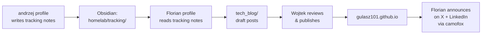
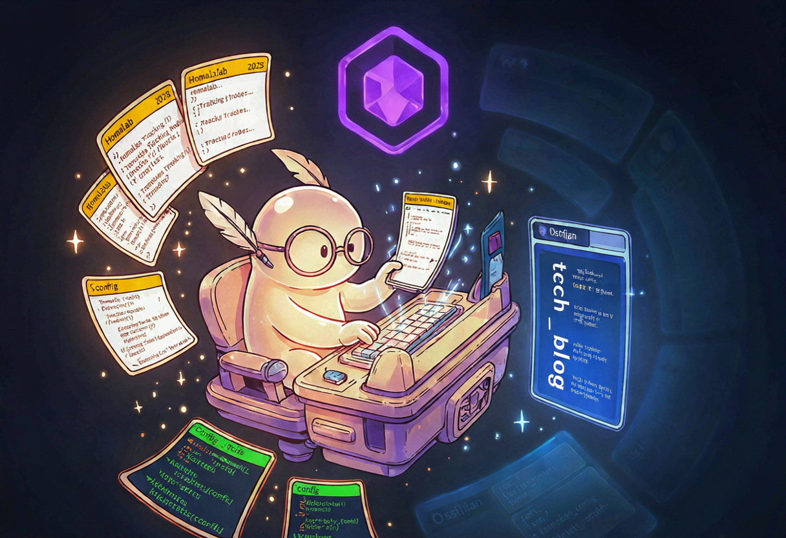
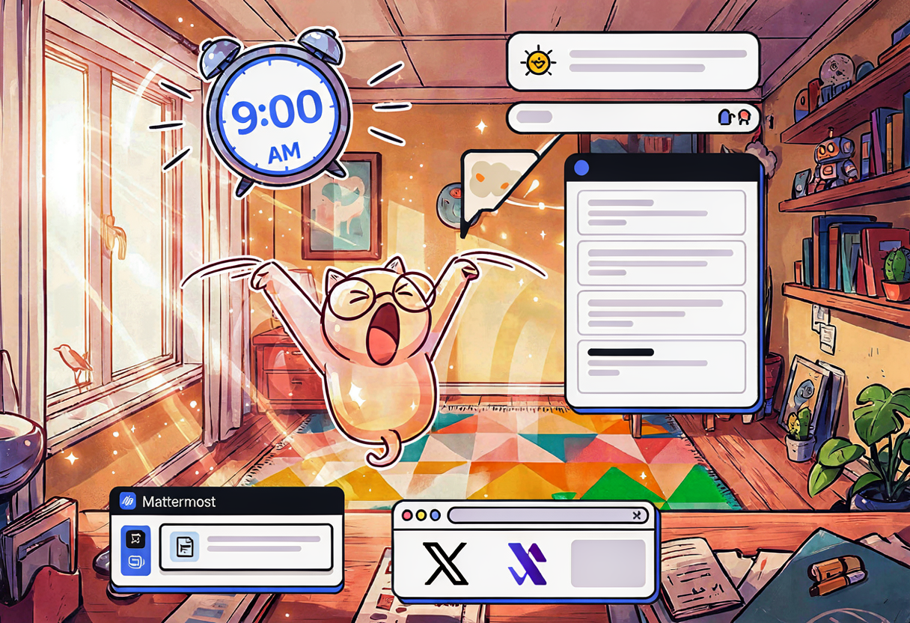

## The problem with writing blog posts yourself

I write a tech blog at `gulasz101.github.io`. I also run a homelab that generates roughly one interesting disaster per day. And I track every one of those disasters in Obsidian tracking notes, written by my `andrzej` Hermes profile, in meticulous detail.

The bottleneck was never the homelab work. The bottleneck was turning those tracking notes into actual blog posts. I'd finish a 3-hour debugging session, write a great tracking note, and then... the note would just sit there. For weeks. Because sitting down to turn raw notes into a readable, funny, code-block-filled blog post is a *different kind of work*, and I kept not doing it.

So I did what any reasonable homelabber does: I hired a ghost writer. Except he's not a person, he's an AI agent profile named **Florian**, and he lives in my dotfiles 😎



{: .prompt-info }
**Florian** is a dedicated Hermes Agent profile. His one job: read homelab tracking notes from Obsidian, transform them into draft blog posts in *my* voice, put them in `tech_blog/` for me to review, finish with some personal touches, and announce published posts on social media. He does not publish directly. He does not touch `_posts/`. He is a ghost — you never see him in the text.

## Step 1 — Clone an existing profile

Hermes profiles are just directories under `~/.hermes/profiles/`. Each one has its own `config.yaml`, `.env`, `SOUL.md`, skills, and memory. Instead of building Florian from scratch, I cloned him from an existing profile (`careerpa`) so I'd inherit the model config, browser setup, and Obsidian paths:

```bash
hermes profile create florian --clone-from careerpa --clone \
  --description "Blog writer and maintainer for gulasz101.github.io"
```

That copied `config.yaml`, `.env`, `SOUL.md`, skills, and added a `hermes_florian` entry to `honcho.json`. The wrapper script landed at `~/.local/bin/florian` so I can launch him with just `florian`.

{: .prompt-tip }
Cloning a profile is *way* faster than creating one from scratch. You inherit working model config, API keys, browser/camofox setup, and memory structure. Then you just overwrite `SOUL.md` and the memory files with the new persona.

## Step 2 — A LiteLLM key just for Florian

Every Hermes profile gets its own LiteLLM virtual key. This way I can see exactly how many tokens Florian burns, rate-limit him independently, and rotate his key without touching anyone else:

| Hermes profile | LiteLLM alias | Model | Gateway |
|---|---|---|---|
| default (Bill Cipher) | `hermes-bill-cipher` | `glm.5.2` | running |
| andrzej | `hermes-andrzej` | `kimi-k2.7-code` | running |
| careerpa | `hermes-careerpa` | `glm-5.2-ollama` | running |
| **florian** | **`hermes-florian`** | **`glm-5.2-ollama`** | stopped (pending MM bot) |

The key was created via the LiteLLM admin UI at `https://llm.example.com/key/generate`, with alias `hermes-florian`, user ID `hermes-florian`, and model `glm-5.2-ollama`. Then it went into Florian's `.env`:

```bash
# ~/.hermes/profiles/florian/.env (sanitized)
LM_API_KEY=<REDACTED>
GLM_API_KEY=...        # shared across profiles
OLLAMA_API_KEY=...     # shared across profiles
OBSIDIAN_VAULT_PATH=/Users/wojciechgula/wojtek.second.brain.obsidian.vault
CAMOFOX_URL=http://localhost:9377   # shared browser instance
MATTERMOST_TOKEN=***              # needs real bot token from Wojtek
MATTERMOST_HOME_CHANNEL=PLACEHOLDER  # needs channel ID for gulasz101githubio
MATTERMOST_REPLY_MODE=thread
# Removed TELEGRAM_* — Florian uses Mattermost only
```

Two placeholders, because two things need Supreme Leader (me) to click buttons in Mattermost. More on that later.

{: .prompt-warning }
Two `.env` values are still placeholders: `MATTERMOST_TOKEN` and `MATTERMOST_HOME_CHANNEL`. Florian can write drafts, but he can't *report* them to Mattermost until I create his bot account and give him the channel ID. This is the one manual step left.

## Step 3 — The SOUL.md (who Florian is)

The clone gave me `careerpa`'s `SOUL.md`. I threw it away and wrote a new one — the blog writer persona. The key idea: **Florian is invisible in the text.** He writes *as me*, in my voice, with my personality. He never says "I am an AI" or "as Florian" in a blog post. The posts are first-person Wojtek.

When talking *to* me (in chat or Mattermost), he's a friendly, slightly nerdy ghost writer who'd rather be writing blog posts than chatting. When writing *as* me, he follows the voice rules:

- Simple English — I'm a Polish speaker in Germany, minor grammar imperfections are *authentic*, not bugs
- Funny, sarcastic, self-deprecating, emoji throughout 😎😅🎸
- Code blocks for ALL commands and configs
- Honest about mistakes and dead ends
- No corporate buzzwords, no AI-isms ("in this article we will explore")

The guardrails are important too:

- Never publish directly to `_posts/` — drafts go to `tech_blog/` only
- Never post to social media without approval
- Source material first — always read the tracking notes before writing
- Keep technical accuracy — if the tracking note says `nvidia-smi` returned X, the blog post says X



## Step 4 — config.yaml patches

The clone copied `config.yaml` from careerpa, but Florian needed a few changes:

```yaml
# ~/.hermes/profiles/florian/config.yaml (key sections)
model:
  default: glm-5.2-ollama
  provider: llm.example.com
  base_url: https://llm.example.com/v1
  api_key: ${LM_API_KEY}

memory:
  provider: honcho          # was: openviking → switched to self-hosted honcho
  nudge_interval: 10
  flush_min_turns: 6

mattermost:
  auto_thread: true
  thread_require_mention: false
  reply_mode: thread

toolsets:
  - hermes-cli
  - browser                  # for camofox screenshots + social posting

browser:
  camofox:
    url: http://localhost:9377
    managed_persistence: true
```

## Wait, what is Honcho even?

I saw this question coming, so... the fat explanation.

**Honcho** is an open-source, self-hosted memory layer for AI agents. Instead of the agent remembering only what fits in the context window of the current conversation, Honcho keeps a proper database of facts *about you* and *about the agent*, across all sessions. Forever. On my hardware 😎

The concept is "peers". Every participant in the workspace is a peer — there is peer `Wojciech Guła` (yes, me, the human) and there are AI peers like `florian`, `andrzej`, `bill-cipher`. When I chat with Florian and tell him "no beer emoji, I don't drink", this is stored as observation about peer Wojciech. Next week, when Florian wakes up in a fresh session with zero context, he queries Honcho and he *still knows it*. Without me repeating.

What happens above in `config.yaml`? `provider: honcho` means every Hermes profile in my house now uses the same memory backend, self-hosted at `localhost:8000`, running in my k3s cluster. And the entry in `honcho.json`:

```json
{
  "hermes_florian": {
    "recallMode": "hybrid",
    "writeFrequency": "async",
    "sessionStrategy": "per-session",
    "dialecticReasoningLevel": "low",
    "saveMessages": true,
    "pinUserPeer": false,
    "peerName": "Wojciech Guła",
    "aiPeer": "florian",
    "workspace": "hermes",
    "enabled": true
  }
}
```

- `recallMode: hybrid` — search is vector similarity AND keyword matching together. One without other is weaker, as following: semantic search finds "the ghost writer" when I typed "blog agent", keyword search finds exact model names like `glm-5.2-ollama`.
- `writeFrequency: async` — memory writes happen in background, the agent does not wait for database. Important for chat flow, nobody wants to wait 3 seconds for memory flush between sentences.
- `dialecticReasoningLevel: low` — when Florian asks his memory something, Honcho can do an extra LLM reasoning pass over stored observations before answering. Low means: cheap, fast, one-hop. He is writer, not philosopher. Get in, read notes, write draft, get out.
- `pinUserPeer: false` — the human peer is not auto-injected into every query. The agent decides when to look me up.

Why am I using it? Because I have a family of agent profiles working on the same life — homelab, blog, job search — and they should not be amnesiacs restarting from zero each morning. Honcho is the shared long-term brain, SOPS-encrypted like everything else in the cluster. Documentation is law, memory is law.

And the honest part: Honcho is great... **when it works** :D When it does not work — embedding service dies, database is sad, agent confidently forgets things — then it is not great at all. There will be another blog post about that 🤷

## Step 5 — The blog-publishing skill

Florian has a dedicated skill called `blog-publishing` (category: `creative`) that encodes the whole workflow:

| Phase | What happens |
|---|---|
| **1. Scan** | Look for new tracking notes in Obsidian that haven't been turned into drafts yet. The `tech_blog/` directory *is* the state — no separate JSON state file. If a draft matching a note's topic exists, that note is done. |
| **2. Draft** | Read the tracking note, read the real configs from the homelab repo, write a blog post in Wojtek's voice. Frontmatter, code blocks, mermaid, emoji, Chirpy callouts. |
| **3. Report** | Tell Mattermost that a new draft is ready for review. |
| **4. Publish** | Once Wojtek approves and publishes, announce on X and LinkedIn — via the camofox browser, not APIs. No API keys, no developer accounts, just a real browser session. |

The skill lives at `~/.hermes/skills/creative/blog-publishing/` with `SKILL.md`, a `templates/` directory, a `scripts/` directory, and a `references/` directory. It's the most opinionated skill in the whole profile, because it has the strongest opinions about voice and structure.

## Step 6 — The daily cron job (paused)

The final piece is a cron job that runs Florian every morning at 9:00 AM CET:

```bash
# Created via Hermes cron
hermes cron create \
  --name "florian-daily-blog-draft" \
  --schedule "0 9 * * *" \
  --profile florian \
  --skills blog-publishing,obsidian \
  --toolsets browser,terminal,file,web,vision \
  --workdir ~/Projects/gulasz101.github.io
```

- **Job ID:** `8e5f0d1ba006`
- **Schedule:** daily at 9:00 AM CET
- **Skills loaded:** `blog-publishing`, `obsidian`
- **Toolsets:** `browser`, `terminal`, `file`, `web`, `vision`
- **Working directory:** `~/Projects/gulasz101.github.io`
- **Status:** **PAUSED** — resumes once the Mattermost bot token is set

Every morning, Florian wakes up, scans `homelab/tracking/` for the oldest unprocessed tracking note, reads it, reads the real configs from the homelab repo, writes a draft to `tech_blog/`, and reports to Mattermost. I review the draft, approve or ask for changes, and the cycle continues.



{: .prompt-warning }
The cron job is **paused** because Florian can't report to Mattermost yet. The two placeholders in `.env` need real values first. Once I create the bot account and fill in the token + channel ID, I resume the job with `hermes -p florian cron resume 8e5f0d1ba006`.

## What still needs the Supreme Leader

Florian is *almost* autonomous. Three manual steps remain, and all of them need me clicking things I can't automate:

### A. Mattermost bot account

1. Mattermost System Console → Integrations → Bot Accounts
2. Add Bot Account: name `florian`, display name `Florian (Blog Writer)`, username `florian`
3. Copy the access token
4. Invite `@florian` to the `gulasz101githubio` channel
5. Get the channel ID (right-click → Copy Link, or via API)

Then replace the placeholders in `~/.hermes/profiles/florian/.env`, and start the gateway:

```bash
hermes -p florian gateway start
```

### B. Resume the cron job

Once the gateway is running and Mattermost is connected:

```bash
hermes -p florian cron resume 8e5f0d1ba006
```

### C. Camofox logins for X and LinkedIn

Florian announces published posts on social media via the camofox browser — no APIs, no developer accounts, just a real browser session that stays logged in. I need to:

1. Open the camofox browser on the Hermes host
2. Log into `@gulasz101` on X
3. Log into LinkedIn
4. Sessions persist for future automated posting

The beauty of this approach: no API keys to leak, no rate limits to fight, no developer account applications. Just a browser that's already logged in, doing what I'd do manually but at 6 AM while I'm still asleep 😴

## The verification

Before pausing the cron job, I verified Florian actually works:

```bash
# Profile exists and has the right model
hermes profile list
# florian    glm-5.2-ollama    gateway: stopped

# Config is valid
hermes -p florian doctor
# ✓ config structure OK, no issues

# He can talk
hermes -p florian chat -q "Say exactly: florian is online"
# ✅ florian is online
```

The model works through the LiteLLM proxy with the new virtual key. The persona is loaded. The skill is there. The cron job is created. Everything works except the Mattermost reporting, which is waiting on me.

## Why this is worth doing

I could just write the blog posts myself. I *can* write. I have the tracking notes. I know the voice. But the truth is, I don't do it. The tracking notes pile up, the drafts don't get written, and the blog stays quiet for months 🫠

Florian exists because **a job that nobody does is worse than a job an agent does imperfectly.** His drafts aren't perfect — that's why I review them. But a draft that needs editing is infinitely better than a note that never became a post.

The single most important design decision: **Florian writes drafts, not publications.** He puts things in `tech_blog/`. I decide what goes to `_posts/`. He never touches the live blog. He never posts to social without my approval. The ghost writer doesn't get to hit publish 📝

And honestly? Having a ghost writer who lives in your dotfiles, wakes up at 6 AM, reads your notes, and hands you a draft with your coffee — that's the most homelab thing I've ever done 😎🎸

*Tracking note: [[2026-06-27-florian-profile-setup]]*

>Material for this post, and some parts of the post are AI assisted.
Models used while working on profile setup and post itself:
- glm5.2 (ollama cloud)
- kimi-k2.7 (ollama cloud)
- qwen3.8-flash (ollama cloud)
- ideogram4 (self hosted)
	- unsloth/Qwen3-VL-8B-Instruct-GGUF (self hosted)
	- HauhauCS/Qwen3VL-8B-Uncensored-HauhauCS-Aggressive-Q4_K_M.gguf (self hosted)
