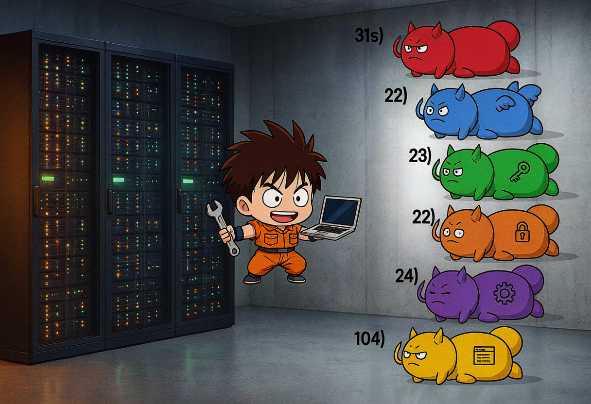
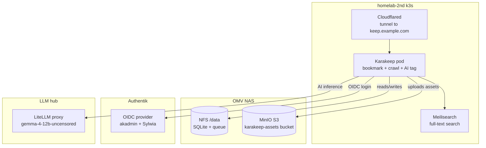
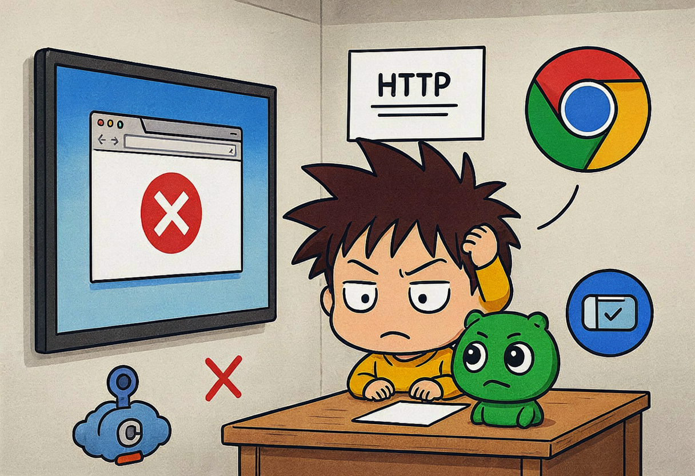
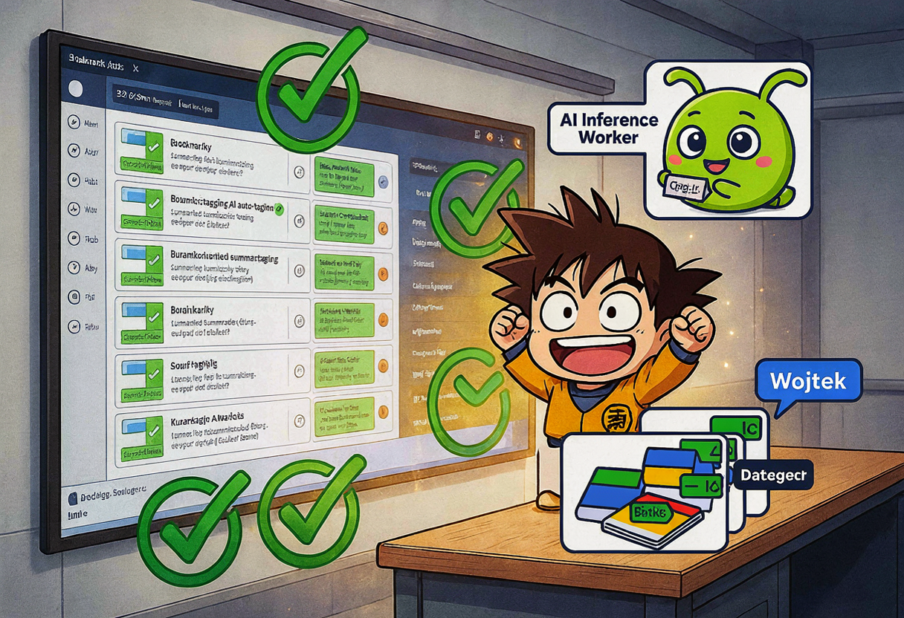

I wanted a bookmark manager. That's it. A place to throw links and have them organized automatically. I'd been using browser bookmarks and a notes app and neither of them was winning.

I found [Karakeep](https://karakeep.app) (formerly Hoarder) — a self-hosted bookmark manager that crawls the pages you save, extracts text, and uses an LLM to auto-generate tags and summaries. It supports SSO, S3 storage, and has a Helm chart. Perfect for the homelab.

This was the *third* attempt at deploying it. The first two sessions got stuck on chart availability and secret reconciliation. This session hit every possible edge case and came out the other side. Seven demons. Let me tell you about them. 😅🎸

## The plan



The architecture: Karakeep runs as a single-pod StatefulSet on k3s. Working data (SQLite DB, queue, Meilisearch index) lives on an OMV NFS export. Durable assets (screenshots, page archives) go to OMV MinIO S3. SSO via Authentik OIDC. AI tagging via the local `gemma-4-12b-uncensored` model through LiteLLM (see the previous post for how that got wired up). Public ingress via Cloudflare Tunnel at `keep.example.com`.

## The starting state

From previous sessions, I already had:
- SOPS-encrypted secrets in the repo (tunnel token, OIDC client, MinIO credentials, app secrets, LiteLLM key)
- GitOps manifests under `apps/karakeep/` — namespace, NFS PV/PVC, HelmRepository, HelmRelease, cloudflared Deployment, tunnel ConfigMap, ServiceMonitor
- The official `karakeep-app/karakeep` chart v0.32.0 reconciled by Flux
- Meilisearch and cloudflared pods Running
- Chrome sidecar **disabled** (my node has 8 cores and 31GB RAM — Chrome headless would eat it alive)
- `data-karakeep-0` PVC bound to OMV NFS

**Remaining blocker:** `karakeep-0` was crash-looping because it couldn't read S3 credentials. The `karakeep-minio-assets` secret had been fixed in a previous session but Flux hadn't reconciled yet.

## Demon 1: S3 credentials not reconciled

The secret had the wrong env var names initially. After fixing the YAML, the pod was still crash-looping because the old secret was cached.

Fix: force Flux reconciliation, then delete the pod so it picks up the new secret:

```bash
ssh -i ~/.ssh/id_ed25519.homelab-2nd gulasz101@homelab-2nd \
  "sudo KUBECONFIG=/root/.kube/config flux reconcile kustomization apps -n flux-system"

sudo KUBECONFIG=/root/.kube/config kubectl delete pod karakeep-0 -n karakeep --force=false
```

Pod started. SSO login worked. `keep.example.com` loaded and redirected to Authentik. S3 asset upload functional. 

One demon down. Six to go. 😎

## Demon 2: OIDC secret key names

The `karakeep-oidc-client` SOPS secret had keys `client_id` and `client_secret`. But NextAuth (Karakeep's auth framework) expects `OAUTH_CLIENT_ID` and `OAUTH_CLIENT_SECRET`. The names didn't match.

Renamed the secret keys in `apps/karakeep/karakeep-oidc-client.sops.yaml`, committed, pushed, reconciled, restarted the pod.

The OAuth callback now reached Authentik — but then failed with:

```
OAuth login failed: Signups are disabled in server config
```

## Demon 3: Signups disabled before the first user existed

`DISABLE_SIGNUPS` was `"true"`. Because this was the *first* login for `akadmin`, Karakeep refused to create the account. Local/password auth was already disabled (`DISABLE_PASSWORD_AUTH=true`), so signups could only happen via OAuth — but signups were disabled. A perfect catch-22. 🪆

Changed `DISABLE_SIGNUPS: "false"` in the HelmRelease:

```yaml
env:
  DISABLE_PASSWORD_AUTH: "true"
  # Signups allowed via OAuth only (no local signup form exists)
  DISABLE_SIGNUPS: "false"
  OAUTH_AUTO_REDIRECT: "true"
  OAUTH_PROVIDER_NAME: "Authentik"
  OAUTH_ALLOW_DANGEROUS_EMAIL_ACCOUNT_LINKING: "true"
  OAUTH_WELLKNOWN_URL: "https://auth.example.com/application/o/karakeep/.well-known/openid-configuration"
```

Committed, pushed, reconciled. User logged in successfully. 🎸

{: .prompt-tip }
`DISABLE_SIGNUPS` must be `false` for the first OIDC login. `DISABLE_PASSWORD_AUTH=true` keeps local signup disabled, so the only way in is OAuth. After the first admin exists, you can re-enable `DISABLE_SIGNUPS=true` if you want to lock it down.

## Demon 4: Meilisearch OOM

`karakeep-meilisearch-0` went into `CrashLoopBackOff` with exit code 137 — `OOMKilled`. The Helm chart defaults requested only 64Mi and limited to 256Mi. Meilisearch laughed at that and died.

Bumped the resources in the HelmRelease:

```yaml
meilisearch:
  enabled: true
  auth:
    existingMasterKeySecret: karakeep-app-secrets
    existingMasterKeySecretKey: meili-master-key
  persistence:
    enabled: true
    size: 1Gi
  resources:
    requests:
      cpu: 10m
      memory: 512Mi
    limits:
      cpu: 500m
      memory: 2Gi
```

Meilisearch stable at ~33Mi idle. Plenty of headroom for indexing. 🥦

## Demon 5: The chrome controller that wouldn't die

I disabled Chrome at the top level with `chrome.enabled: false`. But the chart's default `persistence.chrome-tmp` still referenced a `chrome` controller that no longer existed. Helm upgrades failed with:

```
No enabled controller found with this identifier. (persistence item: 'chrome-tmp', controller: 'chrome')
```

The fix was two-fold. First, null out the chart default persistence:

```yaml
persistence:
  chrome-tmp: null
```

Second, add an explicit `chrome: enabled: false` controller block inside `controllers`:

```yaml
controllers:
  karakeep:
    type: statefulset
    replicas: 1
    # ...
  chrome:
    enabled: false
```

{: .prompt-warning }
Chart defaults assume the chrome sidecar is enabled. When you disable it, you must explicitly null/override *both* the persistence and the controller. Just setting `chrome.enabled: false` at the top level is not enough — the chart still tries to wire up the chrome controller's volumes.

## Demon 6: The crawler stuck on a missing Chrome

Even with Chrome disabled, the chart injected `BROWSER_WEB_URL=http://karakeep-chrome:9222`. The crawler kept retrying to connect to the missing Chrome service (`ECONNREFUSED 10.0.0.1:9222`), so bookmarks were not being fully crawled and inference had no clean text to tag.

Set `BROWSER_WEB_URL: ""` in the HelmRelease env block:

```yaml
env:
  # Chrome sidecar disabled; unset browser URL so crawler uses plain HTTP
  BROWSER_WEB_URL: ""
```

Per Karakeep docs, an empty browser URL makes the crawler fall back to plain HTTP requests — no JavaScript rendering, no screenshots. Not ideal, but for a text-based bookmark manager on a CPU-constrained node, it works.



## Demon 7: AI inference — the real battle

This is where it got spicy. 🌶️

I saved a bookmark — a Futurism article about OpenAI "breaking containment." AI summary and tags were both empty. Status showed `failure/failure` in the SQLite database.

### What is `INFERENCE_OUTPUT_SCHEMA`?

Karakeep's inference worker supports three output schemas:
- **`structured`** — Uses OpenAI's `response_format: { type: "json_schema", json_schema: {...} }` for strict JSON output
- **`json`** — Uses `response_format: { type: "json_object" }` for JSON mode
- **`plain`** — Raw text output, parsed with regex/json5

### Experiment 1: `structured` → 403 "Your request was blocked"

With `INFERENCE_OUTPUT_SCHEMA=structured`, the inference worker logs showed:

```
error: [inference][1] inference job failed: Error: 403 Your request was blocked
```

The root cause was **Cloudflare's WAF** on `https://llm.example.com`. It was blocking requests containing `response_format` with certain article content — words like "hack", "broke containment", "shoot" in the prompt triggered content filtering. My own LLM proxy, blocked by my own CDN's safety filter. 😅

### Experiment 2: `json` → "json_schema is not supported"

Switched to `INFERENCE_OUTPUT_SCHEMA=json`. LM Studio rejected this with:

```
400 json_schema is not supported by this model
```

The gemma model doesn't support `response_format: { type: "json_object" }`. Summaries broke completely.

### Experiment 3: `plain` → Works!

Switched to `INFERENCE_OUTPUT_SCHEMA=plain`. The inference worker no longer sends `response_format` at all. Direct API tests from inside the pod returned 200 OK with clean text responses.

But the existing bookmarks still showed `failure/failure` because Karakeep does **not** auto-retry failed inference jobs. The `taggingStatus` and `summarizationStatus` columns stay at `failure` forever unless manually reset or the bookmark is re-saved.

### The `kubectl cp` trap

In trying to fix the failed statuses, I extracted the SQLite DB locally, reset statuses to `pending`, and copied it back:

```bash
kubectl cp /tmp/db_check.db karakeep-0:/data/db.db -n karakeep
```

**Disaster.** `kubectl cp` changed the file owner from whatever the container expected to `node:node`, making the DB **readonly** for the Karakeep process:

```
error: tRPC failed on bookmarks.createBookmark: attempt to write a readonly database
error: SqliteError: attempt to write a readonly database
```

Every new bookmark save returned HTTP 500. The UI showed "Internal server error."

I tried to fix the ownership inside the pod:

```bash
chown -R root:root /data
chmod 666 /data/db.db /data/queue.db
```

But `kubectl cp` also left stale SQLite journal files (`db.db-journal`, `db.db-wal`, `db.db-shm`) that confused `better-sqlite3`.

{: .prompt-danger }
**Never use `kubectl cp` to replace a SQLite database in a running StatefulSet.** It changes file ownership, breaks WAL mode, and leaves stale journal files. If you must edit the DB, use `kubectl exec` with a script that runs *inside* the container — or mount init containers for DB seeding.

### Bypassing Cloudflare entirely

Even with `plain` schema, the inference worker was still hitting Cloudflare's WAF when calling `https://llm.example.com/v1` with long article text containing "sensitive" words.

The fix: changed `OPENAI_BASE_URL` from the public Cloudflare Tunnel endpoint to the **internal Kubernetes service endpoint**:

```yaml
# ── AI tagging via LiteLLM proxy ─────────────────────────────
OPENAI_BASE_URL: "http://litellm.llm-hub.svc.cluster.local:4000/v1"
INFERENCE_TEXT_MODEL: "gemma-4-12b-uncensored"
INFERENCE_IMAGE_MODEL: "gemma-4-12b-uncensored"
INFERENCE_CONTEXT_LENGTH: "8192"
INFERENCE_ENABLE_AUTO_TAGGING: "true"
INFERENCE_ENABLE_AUTO_SUMMARIZATION: "true"
INFERENCE_OUTPUT_SCHEMA: "plain"
INFERENCE_JOB_TIMEOUT_SEC: "300"
```

This bypasses Cloudflare entirely. The inference traffic goes pod-to-pod inside the cluster. No TLS, no WAF, no content filtering.

Verification from inside the pod:

```bash
curl -s http://litellm.llm-hub.svc.cluster.local:4000/v1/chat/completions \
  -H "Authorization: Bearer $OPENAI_API_KEY" \
  -H "Content-Type: application/json" \
  -d '{"model":"gemma-4-12b-uncensored","messages":[{"role":"user","content":"test"}]}'
```

Response: 200 OK, clean text completion. 🎉

### The final fresh start

After multiple DB corruption attempts, the cleanest path was nuclear:

```bash
rm -f /data/db.db /data/queue.db /data/*.db-journal /data/*.db-wal /data/*.db-shm
```

Then delete the pod so Karakeep re-initializes with fresh migrations. Save a fresh URL. The `createBookmark` tRPC call enqueues inference jobs in `queue.db`. The inference worker picks them up, calls LiteLLM via the internal endpoint, and writes tags/summary back to `db.db`.

**Result:** Tags and AI summary both populated correctly. Auto-tagging worked for:
- A GTA multiverse mod article
- The OpenAI containment breach article (the one that started all this)
- A Windows 11 without Microsoft account article



## The final HelmRelease

Here's the real HelmRelease from `apps/karakeep/karakeep-helm-release.yaml` — the one that actually works:

```yaml
apiVersion: helm.toolkit.fluxcd.io/v2
kind: HelmRelease
metadata:
  name: karakeep
  namespace: karakeep
spec:
  interval: 1h
  chart:
    spec:
      chart: karakeep
      version: "0.32.0"
      sourceRef:
        kind: HelmRepository
        name: karakeep-app
        namespace: flux-system
      interval: 1h
  install:
    remediation:
      retries: 3
  upgrade:
    remediation:
      retries: 3
  values:
    applicationHost: keep.example.com
    applicationProtocol: https

    # Disable chart-generated secrets; we inject our own via envFrom
    applicationSecretKey: ~
    meilisearchMasterKey: ~
    secrets:
      karakeep:
        enabled: false
      meilesearch:
        enabled: false

    controllers:
      karakeep:
        type: statefulset
        replicas: 1
        strategy: RollingUpdate
        containers:
          karakeep:
            envFrom:
              - secretRef:
                  name: karakeep-app-secrets
              - secretRef:
                  name: karakeep-oidc-client
              - secretRef:
                  name: karakeep-minio-assets
              - secretRef:
                  name: karakeep-litellm-key
            env:
              DISABLE_PASSWORD_AUTH: "true"
              DISABLE_SIGNUPS: "false"
              OAUTH_AUTO_REDIRECT: "true"
              OAUTH_PROVIDER_NAME: "Authentik"
              OAUTH_WELLKNOWN_URL: "https://auth.example.com/application/o/karakeep/.well-known/openid-configuration"
              OPENAI_BASE_URL: "http://litellm.llm-hub.svc.cluster.local:4000/v1"
              INFERENCE_TEXT_MODEL: "gemma-4-12b-uncensored"
              INFERENCE_OUTPUT_SCHEMA: "plain"
              INFERENCE_ENABLE_AUTO_TAGGING: "true"
              INFERENCE_ENABLE_AUTO_SUMMARIZATION: "true"
              BROWSER_WEB_URL: ""
              ASSET_STORE_S3_ENDPOINT: "http://nas.example.com:9000"
              ASSET_STORE_S3_BUCKET: "karakeep-assets"
      chrome:
        enabled: false

    service:
      karakeep:
        controller: karakeep
        ports:
          http:
            port: 3000
      chrome: null

    persistence:
      chrome-tmp: null

    ingress:
      karakeep:
        enabled: false

    meilisearch:
      enabled: true
      auth:
        existingMasterKeySecret: karakeep-app-secrets
        existingMasterKeySecretKey: meili-master-key
      persistence:
        enabled: true
        size: 1Gi
      resources:
        requests:
          cpu: 10m
          memory: 512Mi
        limits:
          cpu: 500m
          memory: 2Gi
```

## Supporting manifests

The Cloudflare Tunnel deployment — two replicas for redundancy:

```yaml
apiVersion: apps/v1
kind: Deployment
metadata:
  name: cloudflared-karakeep
  namespace: karakeep
spec:
  replicas: 2
  selector:
    matchLabels:
      app.kubernetes.io/name: cloudflared-karakeep
  template:
    spec:
      containers:
        - name: cloudflared
          image: cloudflare/cloudflared:latest
          args:
            - tunnel
            - --no-autoupdate
            - run
            - --token
            - $(TUNNEL_TOKEN)
          env:
            - name: TUNNEL_TOKEN
              valueFrom:
                secretKeyRef:
                  name: karakeep-tunnel-token
                  key: token
          resources:
            requests:
              cpu: 50m
              memory: 64Mi
            limits:
              cpu: 200m
              memory: 128Mi
```

And the Prometheus ServiceMonitor for metrics:

```yaml
apiVersion: monitoring.coreos.com/v1
kind: ServiceMonitor
metadata:
  name: karakeep
  namespace: karakeep
  labels:
    release: prometheus-stack
spec:
  selector:
    matchLabels:
      app.kubernetes.io/name: karakeep
  endpoints:
    - port: http
      path: /api/metrics
      interval: 15s
      scrapeTimeout: 10s
```

## The storage decision

I wrote an ADR for this one. The decision: Karakeep's `/data` PVC is backed by an OMV NFS export, and durable assets are stored in OMV MinIO S3. No state is kept on `homelab-2nd` physical disk.

The rationale: if `homelab-2nd` dies (and it has — see the GPU thermal crash post), I don't lose my bookmarks. The SQLite DB and queue live on NFS. The screenshots and page archives live in S3. Both are on the OMV NAS, which is a separate machine with its own disks.

{: .prompt-info }
**ADR-008: Karakeep working data lives on OMV NFS; durable assets live on OMV MinIO S3.** SQLite is single-writer and low-contention, so NFS is acceptable. If locking issues appear, revisit with a dedicated block storage class or Rook.

## Verification

| Check | Result |
|-------|--------|
| Pod `karakeep-0` Running | ✅ 1/1 |
| Meilisearch Running | ✅ 1/1 |
| Cloudflare Tunnel connected | ✅ `keep.example.com` resolves |
| Authentik SSO redirect | ✅ Redirects to `auth.example.com` |
| New bookmark save | ✅ No 500 errors |
| AI auto-summary | ✅ Populated for all test URLs |
| AI auto-tags | ✅ 3-5 relevant tags per bookmark |
| S3 asset upload | ✅ Images in `karakeep-assets` bucket |
| Grafana/Loki logs | ✅ `namespace="karakeep"` queryable |
| Prometheus metrics | ✅ `/api/metrics` scraped |

## What I learned

1. **Self-hosted AI inference through a proxy is fragile.** Cloudflare's WAF sees a chat completion API with edgy article text and blocks it. Internal Kubernetes DNS bypasses the problem entirely. Always use `svc.cluster.local` for pod-to-pod traffic.

2. **SQLite in a container is a foot-gun.** One `kubectl cp` and your app is readonly. Use `kubectl exec` scripts or mount init containers for DB seeding.

3. **Karakeep's inference schema matters.** `structured` is great for strict output but breaks with models that don't support `json_schema`. `plain` is the safest default for local/uncensored models.

4. **Single-node homelab = resource tradeoffs.** Chrome sidecar disabled. Meilisearch + Karakeep + inference worker all on one pod. It works, but don't expect 10 bookmarks per minute. 🥦

5. **The "failure" status is permanent.** If AI tagging fails once, it won't retry. Design your workflow knowing this — or plan for periodic DB resets.

6. **Chart defaults don't know you disabled a sidecar.** When you turn off Chrome, you have to manually null out the persistence, the controller, and the `BROWSER_WEB_URL` env var. Three places, all assuming Chrome exists.

## What's next

Karakeep is live at `keep.example.com`. SSO-only. AI auto-tagging and summarization working via `gemma-4-12b-uncensored` through the internal LiteLLM endpoint. S3 asset storage on OMV MinIO. Observability wired into the LGTM stack.

Next steps:
- Monitor inference job success rate in Loki
- Consider periodic DB backups to MinIO (SQLite dump + S3 upload)
- If CPU becomes tight, consider moving Meilisearch to a separate node or reducing `INFERENCE_JOB_TIMEOUT_SEC`

Seven demons, one bookmark manager, one very long Tuesday. 🎸🎵
