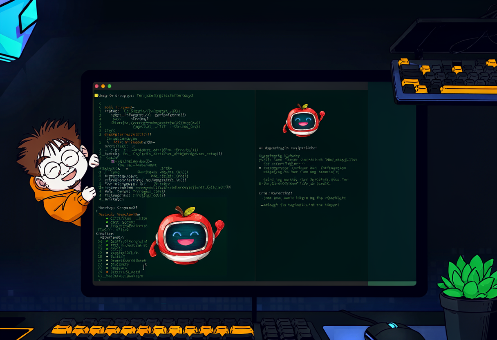
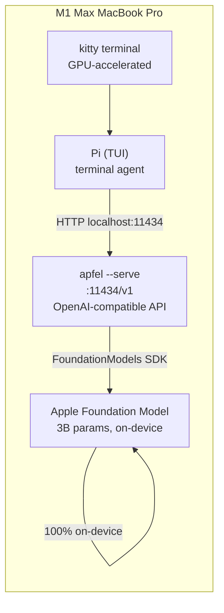

So here's a thing I discovered recently. Every Apple Silicon Mac running macOS 26 Tahoe or later ships with a **free, built-in LLM**. It's called Apple Foundation Model, it's a ~3 billion parameter model that runs 100% on-device, and it costs nothing. No API key, no cloud, no network. It's just... there. Sitting on your chip. Waiting.

And it has a context window of **4096 tokens**.

4096. That's not a context window, that's a Post-it note 😅

To put that in perspective: this blog post is roughly 3500 tokens. The model literally cannot read this post and answer a question about it at the same time. It's like asking someone to summarize a book they're reading through a straw 🥦

Naturally, my first thought was: *"I should put this in my terminal."*

## What is apfel?

[apfel](https://github.com/Arthur-Ficial/apfel) is a CLI tool that exposes Apple's built-in Foundation Model as a UNIX pipe and an OpenAI-compatible server. You install it with Homebrew:

```bash
brew install apfel
```

And suddenly the model that was trapped inside Apple Intelligence is now a first-class terminal citizen:

```bash
# Ask it something
apfel "What is the capital of Austria?"

# Pipe stuff into it
echo "Summarize this: $(cat README.md)" | apfel

# It even does JSON output
apfel -o json "Translate to German: hello" | jq .content

# Or just get code, no prose
apfel --code "a python function that deduplicates a list" > dedupe.py
```

No API keys. No cloud. No network calls. Just the M-series chip doing its thing. It's like having a very small, very forgetful colleague who lives inside your CPU and never asks for a raise 😎

The key trick: `apfel --serve` starts an OpenAI-compatible API server on `localhost:11434` — the same port Ollama uses. Which means anything that speaks the OpenAI API can talk to Apple's on-device model. No modifications needed.

So I thought: what if I plugged this into a terminal AI agent?

## Enter Pi — the silly part

[Pi](https://pi.dev/) is a terminal-based AI coding agent by Mario Zechner (the libGDX guy, if you've been around the Java game dev world). It's like Claude Code or Codex CLI, but minimal and hackable. It runs in the terminal, has a nice TUI, and supports 15+ providers — Anthropic, OpenAI, Ollama, and custom ones via `models.json`.

And here's where the silly idea comes in. Pi lets you define custom providers. Since apfel speaks the OpenAI API, you can just... point Pi at it:

```json
{
  "providers": {
    "apfel": {
      "baseUrl": "http://localhost:11434/v1",
      "api": "openai-completions",
      "apiKey": "ollama",
      "models": [
        {
          "id": "apple-foundationmodel",
          "contextWindow": 4096
        }
      ]
    }
  }
}
```

That's it. Start apfel in the background:

```bash
brew services start apfel
```

Fire up Pi, switch to the `apfel` provider with `Ctrl+L`, and now you have a terminal AI agent powered by a 3B model with a 4096 token context window. Is this a good idea? Probably not. Does it work? Surprisingly... yes 😎



## Why this doesn't immediately explode

Here's the part that actually makes this combo work instead of being a pure joke. Most AI coding agents ship with *massive* system prompts — thousands of tokens of instructions before you even type your first message. On a 200K context window that's fine. On 4096? You'd blow through your entire budget before saying a word.

Pi takes the opposite approach. Mario's philosophy is simple: modern models have been RL-trained so heavily on coding agent tasks that they already know what to do. A 10,000-token system prompt mostly tells the model things it already knows, while burning context that could go toward your actual work.

Pi's base system prompt is roughly 200 tokens of plain English:

```markdown
You are an expert coding assistant. You help users with coding tasks by
reading files, executing commands, editing code, and writing new files.

Available tools:
- read: Read file contents
- bash: Execute bash commands
- edit: Make surgical edits to files
- write: Create or overwrite files

Guidelines:
- Use bash for file operations like ls, grep, find
- Use read to examine files before editing
- Use edit for precise changes (old text must match exactly)
- Use write only for new files or complete rewrites
- When summarizing your actions, output plain text directly
- Be concise in your responses
- Show file paths clearly when working with files
```

That's it. No multi-page safety preamble, no "you are a helpful assistant who..." essay. Just "here's what you do, here's your tools, go." Mario says the [system prompt and tool definitions together come in below 1000 tokens](https://mariozechner.at/posts/2025-11-30-pi-coding-agent/).

{: .prompt-info }
The "~200 tokens" figure is widely reported in [secondary coverage](https://www.solosoft.dev/post/pi-minimal-coding-agent-harness/) and [community analysis](https://zhuanlan.zhihu.com/p/2035485646383469791), but I couldn't find it stated as an exact number in Pi's [official docs](https://pi.dev/docs/latest/usage) or [repo](https://github.com/earendil-works/pi). Treat it as "roughly right for the bare template" rather than an officially documented exact number. You can inspect the real payload with the `pi-context-usage` extension's `/context` command.

Now, Pi's docs describe the system prompt as **built dynamically** at runtime — the base text plus tool definitions, your `AGENTS.md` project context (loaded hierarchically from `~/.pi/agent/` down through parent directories), skills (loaded on-demand, not all at once), and extensions. So the real per-session prompt is a bit bigger than 200 tokens. But even with tools + a small AGENTS.md, it stays well under 1000.

Which means: out of the 4096-token window, you still have **over 3000 tokens** for your actual question and the model's answer. That's tight, but it's not impossible. And for what I'm using it for, it's plenty.

### A funny aside about Claude Code's system prompt

Speaking of system prompt sizes — and I want to be clear, this is an unverified GitHub issue, not a peer-reviewed paper, so take it with a grain of salt 😅

Someone [filed an issue on the Claude Code repo](https://github.com/anthropics/claude-code/issues/45188) claiming that between versions 2.1.89 and 2.1.96 (roughly 5 days in early April 2026), the initial system prompt grew by **~70K tokens**. They measured it by correlating `cache_creation_input_tokens` from the first assistant message in session JSONL files against version numbers. The baseline allegedly went from ~38-52K to ~112-119K. Just the system prompt. Before you type a single character.

Is this accurate? I don't know. The issue was closed as "not planned." Other commenters suggested the growth might be amplified by plugin/skill count rather than the base prompt itself. I have not independently verified this. It could be wrong. It could be a measurement artifact. It could be someone's plugin config.

But here's the thing that made me laugh: **if the 112K number is even remotely close to true, Claude Code's system prompt is 27× larger than apfel's entire context window.** You couldn't even *load the system prompt* into apfel, let alone ask it a question. The instructions alone would overflow the model 27 times over. That's not a technical observation, that's pure comedy 🤷

Anyway. Back to our tiny apple.

## So why would anyone do this?

Because it's surprisingly good at one specific thing: **quick command lookups.**

You know the feeling — you're in the terminal, you need a specific `ffmpeg` flag, or you can't remember if it's `tar -xzf` or `tar -xfz` (it's the first one, I checked), or you need to remember the exact `kubectl` command to exec into a pod in a specific namespace. You could open a browser, search, click a Stack Overflow link, scroll past the life story of someone's cat, and find the answer. Or you could just... ask.

```bash
# In Pi, with apfel as the backend:
> how do I extract a .tar.gz file?

tar -xzf archive.tar.gz
- x: extract
- z: gzip decompression
- f: file (required)
```

The model is small, but for "summarize the man page and give me the one flag I need" tasks, it doesn't need to be big. It needs to be *fast* and *there*. And it is — responses come back in a couple of seconds, no network round-trip, no API quota, no rate limit.

Some things I've actually used it for:

- **"What's the jq syntax to filter by a nested key?"** — got the answer faster than I could type the Stack Overflow URL
- **"Give me the rsync flags for dry-run with delete and progress"** — `--dry-run --delete --progress`, bam
- **"What does `git reflog` do?"** — short, accurate, no 2000-word blog post attached
- **"Convert this date to epoch"** — it just... did it

These are all things where a 3B model is *enough*. You don't need GPT-5 to tell you that `tar -xzf` is the right order. You just need something that knows the man page and can give you the one line you need 😎

## The terminal-native experience

Here's the part I didn't expect to like as much as I do: having an AI chat *in the terminal* is genuinely nice.

I spend most of my day in [kitty](https://sw.kovidgoyal.net/kitty/) — the GPU-accelerated terminal emulator by Kovid Goyal. If you live in the terminal like I do, kitty is made for you. Tabs, splits, ligatures, image rendering, remote control via `kitty @`, scrollback buffers longer than your patience — it's the terminal I didn't know I needed until I tried it.

And when Pi is running inside kitty, the whole experience just... flows. No context switch to a browser. No tab juggling. No "wait which window had the AI chat?" You're already in the terminal, the terminal is your home, and the AI is just another pane next to your code.

```text
┌─────────────────────────────┬──────────────────────────────┐
│                             │  > how do I find the largest │
│  $ du -sh * | sort -rh      │    files in a directory?     │
│  4.2G  node_modules         │                              │
│  2.1G  .git                 │  du -sh * | sort -rh         │
│  890M  target               │  -sh: summary + human-readable│
│  340M  dist                 │  -r: reverse (largest first) │
│  $ _                        │  -h: human-readable sizes    │
│                             │                              │
│  (your terminal)            │  (Pi + apfel, right there)   │
└─────────────────────────────┴──────────────────────────────┘
```

And honestly — who would leave the terminal if you can use [kitty](https://sw.kovidgoyal.net/kitty/)? 😏

## The honest part — what it can't do

Let me not pretend this is some hidden gem that replaces your cloud LLM. It's not. Here's what 4096 tokens and a 3B model actually means:

| Task | Can it do it? | Reality |
|------|:---:|---|
| Quick command syntax lookup | ✅ | This is its sweet spot |
| One-line explanations | ✅ | "What does this flag do?" — perfect |
| Summarize a man page section | ✅ | As long as the section fits in ~2000 tokens |
| Write a full script | 🟡 | Short ones yes, anything complex gets lost |
| Summarize a whole file | ❌ | Anything over ~3000 tokens of input is doomed |
| Multi-turn code reasoning | ❌ | It forgets what it said 2 turns ago |
| Replace Claude/GPT/Claude Code | ❌ | Absolutely not, not even close |
| Know what day it is | ❌ | The model doesn't know the current date. Inject it via system prompt if you need it: `apfel -s "Today is $(date '+%B %d, %Y')."` |

The context window is input *and* output combined. So if your prompt is 3000 tokens, the model has ~1000 tokens left to answer. That's a paragraph. Maybe two. It's not going to write your README 😅

Apple says macOS 27 will bump this to 8192 tokens, which doubles the room. But even at 8192, this is a pocket knife, not a Swiss army knife. You use it for the thing it's good at and reach for the real tools when you need them.

## The architecture (if you can call it that)



No network. No API key. No cloud. No telemetry. Just a model that lives on the chip, a CLI that exposes it, and a TUI that talks to it. The entire stack runs offline on a MacBook. That's the whole thing 🎸

## Should you try it?

If you have an Apple Silicon Mac running macOS 26 Tahoe or later, and you spend time in the terminal — yes, absolutely. It costs nothing (literally — `brew install apfel`, no account, no key), runs on-device, and fills a niche you didn't know you had: the "I just need to remember one flag" niche.

For me, the combo of apfel + Pi in kitty has become one of those small quality-of-life things that adds up. It's not going to write your Kubernetes manifests or debug your Helm chart. But when you're in the middle of something and just need to know "is it `--strip-components 1` or `--strip-components=1`?", having the answer two seconds later without leaving the terminal is... nice.

Is it useless? Mostly, yes. Is it surprisingly useful? Also yes. Both things are true at the same time and I think that's the funniest part 🤷

Now if you'll excuse me, I need to ask a 3B model how to sort a CSV by the third column. It probably knows. Probably 😎🎸

---

## References

- [apfel](https://github.com/Arthur-Ficial/apfel) — Apple Foundation Model as a UNIX tool + OpenAI-compatible server
- [Pi](https://pi.dev/) — minimal terminal AI coding agent by Mario Zechner
- [Pi docs — Usage](https://pi.dev/docs/latest/usage) — context files, system prompt, AGENTS.md, sessions
- [Pi blog post by Mario Zechner](https://mariozechner.at/posts/2025-11-30-pi-coding-agent/) — "What I learned building an opinionated and minimal coding agent" (system prompt, design philosophy, Terminal-Bench results)
- [Pi system prompt source](https://github.com/earendil-works/pi/blob/main/packages/coding-agent/src/core/system-prompt.ts) — the actual `system-prompt.ts` on GitHub
- [SoloSoft: Pi Coding Agent — The Minimalist Harness](https://www.solosoft.dev/post/pi-minimal-coding-agent-harness/) — secondary analysis of Pi's ~200 token system prompt
- [InsiderLLM: Best Local Models for Pi Agent](https://insiderllm.com/guides/pi-agent-local-models-ollama/) — the 200-token system prompt design philosophy explained
- [Zhihu: Pi Coding Agent analysis](https://zhuanlan.zhihu.com/p/2035485646383469791) — "Frontier models don't need hand-holding. 200 tokens for system prompt."
- [How Pi Builds Its System Prompt at Runtime](https://www.akshayparkhi.net/2026/Mar/7/how-pi-builds-its-system-prompt-at-runtime-and-the-innovations-t/) — deep dive into the dynamic assembly process
- [Customizing Pi's System Prompt by Marga Satrya](https://gasatrya.com/blog/customizing-pi-system-prompt/) — building an extension to inspect the real system prompt payload
- [Claude Code system prompt bloat issue #45188](https://github.com/anthropics/claude-code/issues/45188) — unverified GitHub issue reporting ~70K token growth in 5 days; closed as "not planned." The 27× comparison to apfel's context window is comedy, not a verified measurement 😅
- [kitty terminal](https://sw.kovidgoyal.net/kitty/) — GPU-accelerated terminal emulator by Kovid Goyal
- [Apple Foundation Models](https://developer.apple.com/documentation/foundationmodels) — Apple's on-device LLM framework