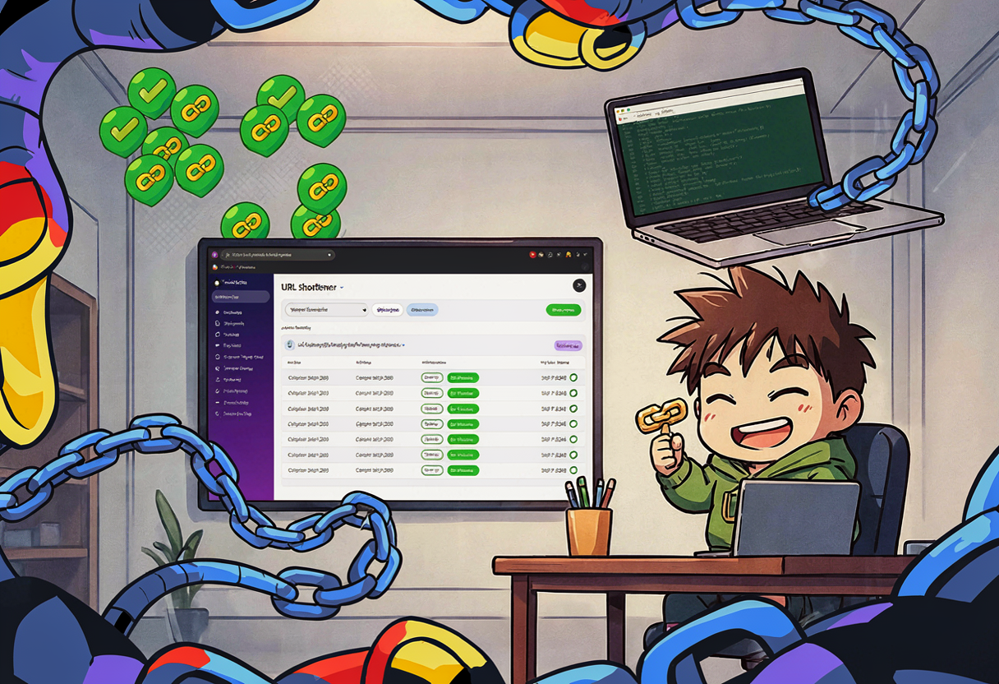
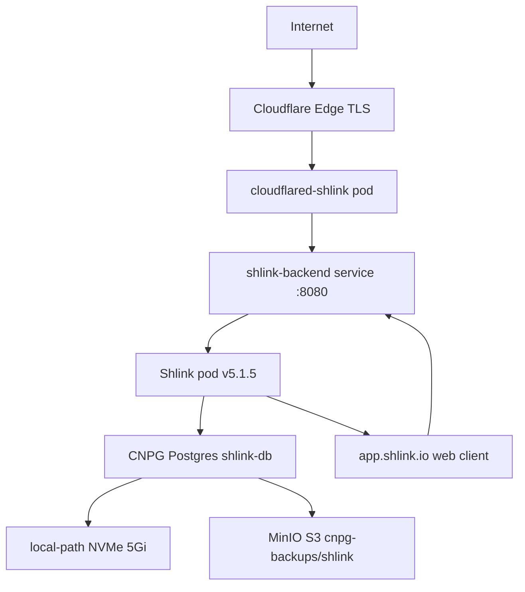

I needed a URL shortener. Not because I have millions of clicks to track, but because every time I share a blog post link on social media, the URL looks like this:

```
https://gulasz101.github.io/posts/apfel-pi-the-tiniest-brain-in-the-terminal/
```

That's 73 characters of "I dare you to click this on mobile." So I went looking for a self-hosted URL shortener that fits the homelab GitOps assembly line, and I found Shlink. And then Shlink taught me a lesson about SSO assumptions. 😎

## What is Shlink and why bother?

[Shlink](https://shlink.io) is a mature, self-hosted URL shortener with a REST API and an official web client. It's PHP under the hood (RoadRunner, not Apache — more on that later), stores everything in Postgres, and has visit tracking with geolocation if you feed it a MaxMind license key.

Why Shlink specifically?

- **Stateless container.** All durability lives in Postgres or object storage. The pod itself is disposable.
- **REST API.** I can create short URLs programmatically — from cron jobs, from Hermes agents, from social media automation.
- **Fits the pattern.** One service, one CNPG database, one Cloudflare Tunnel, one set of alerts. This is the homelab assembly line.
- **Good blog material.** It demonstrates how to deploy an app that has *no native SSO* without breaking the homelab's SSO-first posture.

That last point turned out to be the interesting one. 🎸

## What I learned from the docs (before touching any YAML)

Before writing a single manifest, I indexed the Shlink documentation into the homelab docs-mcp-server. Here's what I found:

- **No native SSO/OIDC.** GitHub issue [shlinkio/shlink#1983](https://github.com/shlinkio/shlink/issues/1983) is still there to look at as of v5.1.5. The application authenticates via API keys only.
- **Database:** external Postgres strongly recommended. SQLite is for testing only.
- **Runtime:** the Docker image uses RoadRunner, so background tasks (GeoLite download, visit geolocation) run inside the container. No separate CronJob needed.
- **Reverse proxy:** must forward `Host`, `X-Forwarded-For`, and `X-Forwarded-Proto`. `TRUSTED_PROXIES` must be configured or every visit appears to come from the Cloudflare tunnel IP range.
- **Health:** `/rest/health` requires no authentication.
- **Metrics:** Shlink does **not** expose Prometheus-format app metrics. We only get `/rest/health` + kubelet/container metrics.
- **Web client:** can be hosted at `https://app.shlink.io` and pointed at our public API, or self-hosted.

{: .prompt-warning }
Shlink has no Prometheus `/metrics` endpoint. If you're used to LGTM dashboards showing per-service request rates, error budgets, and latency histograms — Shlink won't give you that. You get container CPU/memory, health-check `up{}`, and log-based alerts. That's it.

## The architecture

Same GitOps pattern as every other service in the homelab:



The file layout in the homelab-2nd repo:

```text
apps/shlink/
├── namespace.yaml
├── shlink-helm-repository.yaml
├── shlink-helm-release.yaml
├── postgres-cluster.yaml
├── objectstore.yaml
├── scheduled-backup.yaml
├── shlink-db-credentials.sops.yaml
├── shlink-minio-backup-creds.sops.yaml
├── shlink-tunnel-token.sops.yaml
├── shlink-tunnel-ingress-configmap.yaml
├── cloudflared-shlink-deployment.yaml
├── shlink-initial-api-key.sops.yaml
├── shlink-mattermost-webhook-url.sops.yaml
├── shlink-alertmanager-config.yaml
├── shlink-prometheus-rules.yaml
├── shlink-loki-rule.yaml
└── shlink-dashboard-configmap.yaml
```

Plus an update to `apps/kustomization.yaml` to include the new directory.

## Step 1: The database (CNPG Postgres)

Every persistent service in the homelab gets a CloudNativePG Postgres cluster. Shlink is no exception. One instance on `local-path` NVMe for live data, backups and WAL archiving to OMV MinIO for durability.

```yaml
apiVersion: postgresql.cnpg.io/v1
kind: Cluster
metadata:
  name: shlink-db
  namespace: shlink
spec:
  instances: 1
  bootstrap:
    initdb:
      database: shlink
      owner: shlink
      secret:
        name: shlink-db-credentials
  storage:
    size: 5Gi
    storageClass: local-path
  backup:
    barmanObjectStore:
      destinationPath: s3://cnpg-backups/shlink/
      endpointURL: http://nas.example.com:9000
      s3Credentials:
        accessKeyId:
          name: shlink-minio-backup-creds
          key: ACCESS_KEY_ID
        secretAccessKey:
          name: shlink-minio-backup-creds
          key: ACCESS_SECRET_KEY
      wal:
        compression: gzip
      data:
        compression: gzip
  scheduledBackup:
    - name: daily-backup
      schedule: "0 3 * * *"
      backupOwnerReference: self
```

{: .prompt-info }
The `barmanObjectStore` section means every WAL file gets shipped to MinIO in real time. If the NVMe drive dies, I can restore from S3 to the last transaction. This is the same backup pattern I use for Authentik, OpenGist, and every other stateful service.

The daily scheduled backup uses the Barman Cloud CNPG plugin:

```yaml
apiVersion: postgresql.cnpg.io/v1
kind: ScheduledBackup
metadata:
  name: shlink-db-daily
  namespace: shlink
spec:
  schedule: "0 3 * * *"
  backupOwnerReference: self
  cluster:
    name: shlink-db
  method: plugin
  pluginConfiguration:
    name: barman-cloud.cloudnative-pg.io
  immediate: true
```

## Step 2: The HelmRelease

There's no official Shlink Helm chart. The community chart `christianhuth/shlink-backend` is a thin wrapper around a Deployment — which is exactly what I want. No hidden templates, no surprise ConfigMaps, just the app.

```yaml
apiVersion: helm.toolkit.fluxcd.io/v2
kind: HelmRelease
metadata:
  name: shlink-backend
  namespace: shlink
spec:
  interval: 1h
  chart:
    spec:
      chart: shlink-backend
      version: "11.8.0"
      sourceRef:
        kind: HelmRepository
        name: christianhuth
        namespace: flux-system
      interval: 1h
  install:
    remediation:
      retries: 3
  upgrade:
    remediation:
      retries: 3
  values:
    replicaCount: 1
    image:
      tag: "5.1.5"
      pullPolicy: IfNotPresent
    service:
      type: ClusterIP
      port: 8080
    ingress:
      enabled: false
    podAnnotations:
      prometheus.io/scrape: "true"
      prometheus.io/port: "8080"
      prometheus.io/path: "/rest/health"
    resources:
      requests:
        cpu: 50m
        memory: 256Mi
      limits:
        cpu: 500m
        memory: 512Mi
    config:
      database:
        driver: postgres
        host: shlink-db-rw.shlink.svc.cluster.local
        port: 5432
        auth:
          database: shlink
          username: shlink
          existingSecret: shlink-db-credentials
      general:
        defaultDomain: shlink.example.com
        isHttpsEnabled: true
        memoryLimit: "512M"
        timezone: "Europe/Berlin"
      geolite:
        licenseKey: ""
        skipInitialDownload: true
      urlShortening:
        autoResolveTitles: true
        defaultShortCodesLength: 5
    extraEnv:
      - name: TRUSTED_PROXIES
        value: "10.0.0.1/12,10.0.0.0/8,10.0.0.2/16"
      - name: INITIAL_API_KEY
        valueFrom:
          secretKeyRef:
            name: shlink-initial-api-key
            key: INITIAL_API_KEY
```

A few things worth pointing out:

- **`ingress.enabled: false`** — we use Cloudflare Tunnels, not Kubernetes Ingress. Every service in the homelab does this.
- **`prometheus.io/path: "/rest/health"`** — since Shlink has no `/metrics` endpoint, we scrape the health endpoint. This gives us `up{}` and nothing else from the app itself.
- **`TRUSTED_PROXIES`** — without this, every visit shows up as coming from the Cloudflare tunnel IP. Shlink needs to know which proxy ranges to trust so it can read `X-Forwarded-For`.
- **`INITIAL_API_KEY`** — generated, SOPS-encrypted, and injected via `secretKeyRef`. The API key is the *only* admin credential, so it goes straight into SOPS + 1Password.
- **GeoLite2 skipped** — I don't have a MaxMind license key yet. Visit geolocation will show "unknown" until I get one.

{: .prompt-warning }
The chart expects the DB secret key `database-password`, but CNPG's `initdb` expects `password`. Include both keys in the same SOPS-encrypted secret or Shlink will fail to connect on first boot. Ask me how I know. 😅

## Step 3: The Cloudflare Tunnel

One tunnel, one pod, one config reminder:

```yaml
apiVersion: apps/v1
kind: Deployment
metadata:
  name: cloudflared-shlink
  namespace: shlink
  labels:
    app.kubernetes.io/name: cloudflared-shlink
    app.kubernetes.io/component: tunnel
spec:
  replicas: 1
  selector:
    matchLabels:
      app.kubernetes.io/name: cloudflared-shlink
  template:
    metadata:
      labels:
        app.kubernetes.io/name: cloudflared-shlink
        app.kubernetes.io/component: tunnel
    spec:
      containers:
        - name: cloudflared
          image: cloudflare/cloudflared:latest
          args:
            - tunnel
            - --no-autoupdate
            - run
            - --token
            - $(TUNNEL_TOKEN)
            - --url
            - http://shlink-backend.shlink.svc.cluster.local:8080
          env:
            - name: TUNNEL_TOKEN
              valueFrom:
                secretKeyRef:
                  name: shlink-tunnel-token
                  key: token
          resources:
            requests:
              cpu: 50m
              memory: 64Mi
            limits:
              cpu: 200m
              memory: 128Mi
```

The tunnel token is SOPS-encrypted in `shlink-tunnel-token.sops.yaml`. The public hostname rule (`shlink.example.com → http://shlink-backend.shlink.svc.cluster.local:8080`) is configured in the Cloudflare Zero Trust dashboard, and a ConfigMap in the repo documents it so future-me doesn't forget:

```yaml
apiVersion: v1
kind: ConfigMap
metadata:
  name: shlink-tunnel-ingress
  namespace: shlink
data:
  public-hostname: "shlink.example.com"
  origin: "http://shlink-backend.shlink.svc.cluster.local:8080"
  note: "Configure this origin in Cloudflare Zero Trust -> Networks -> Tunnels -> shlink"
```

## Step 4: Observability (the honest(ish) part)


Here's the thing: Shlink doesn't expose Prometheus metrics. No `/metrics` endpoint, no request rate, no error budget, no latency histogram. The dashboard and alerts rely entirely on container-level metrics from cAdvisor and kubelet.

### Prometheus rules (container-level only)

```yaml
apiVersion: monitoring.coreos.com/v1
kind: PrometheusRule
metadata:
  name: shlink-resource-alerts
  namespace: shlink
  labels:
    release: kube-prometheus-stack
spec:
  groups:
    - name: shlink.resources
      interval: 30s
      rules:
        - alert: ShlinkCPUAboveRequest
          expr: |
            sum by (pod, container, namespace) (
              rate(container_cpu_usage_seconds_total{namespace="shlink", container!=""}[5m])
            ) >
            sum by (pod, container, namespace) (
              kube_pod_container_resource_requests{namespace="shlink", resource="cpu", container!=""}
            )
          for: 5m
          labels:
            severity: warning
            namespace: shlink
          annotations:
            summary: "shlink/{{ $labels.pod }} CPU above request"
        - alert: ShlinkMemoryAboveRequest
          expr: |
            sum by (pod, container, namespace) (
              container_memory_working_set_bytes{namespace="shlink", container!=""}
            ) >
            sum by (pod, container, namespace) (
              kube_pod_container_resource_requests{namespace="shlink", resource="memory", container!=""}
            )
          for: 5m
          labels:
            severity: warning
            namespace: shlink
          annotations:
            summary: "shlink/{{ $labels.pod }} memory above request"
```

These are the same four rules I deploy for every namespace: CPU above request, memory above request, CPU above 90% of limit, memory above 90% of limit. They don't tell me *why* Shlink is using resources — just *that* it is.

### Loki log alerts (the real signal)

Since there are no app metrics, log-based alerts do the heavy lifting:

```yaml
apiVersion: v1
kind: ConfigMap
metadata:
  name: shlink-loki-rules
  namespace: observability
  labels:
    loki_rule: "true"
data:
  shlink-http-errors.yaml: |
    groups:
      - name: shlink.http-errors
        interval: 1m
        rules:
          - alert: ShlinkNon2xxResponses
            expr: |
              sum by (pod, namespace) (
                count_over_time(
                  {namespace="shlink", pod=~"shlink-backend-.*"}
                    |~ "status\":\s*[3-9]\d{2}"
                  [5m]
                )
              ) > 0
            for: 2m
            labels:
              severity: warning
              namespace: shlink
            annotations:
              summary: "Shlink endpoint returned non-2xx status"
              description: "{{ $labels.pod }} logged non-2xx HTTP responses in the last 5 minutes."
```

This regex-matches log lines containing `"status": 3xx/4xx/5xx` and fires if any show up in a 5-minute window. It's not as precise as a Prometheus histogram, but it catches real errors.

### Alertmanager → Mattermost

```yaml
apiVersion: monitoring.coreos.com/v1alpha1
kind: AlertmanagerConfig
metadata:
  name: shlink-mattermost-alerts
  namespace: shlink
  labels:
    release: kube-prometheus-stack
spec:
  route:
    receiver: shlink-mattermost
    matchers:
      - name: namespace
        value: shlink
        matchType: "="
  receivers:
    - name: shlink-mattermost
      webhookConfigs:
        - urlSecret:
            name: shlink-mattermost-webhook-url
            key: url
          sendResolved: true
          maxAlerts: 10
```

Same pattern as every other namespace: alerts route to a Mattermost webhook, resolved alerts get sent too (so I know when things go green again), and the webhook URL is SOPS-encrypted.

## SSO — the hard truth 😅


Here's where it gets interesting. The homelab has an SSO-first posture. Authentik is the central identity provider. Every service that supports OIDC gets wired up to it — Mattermost, Open WebUI, Nextcloud, tldraw.

Shlink does not support OIDC. Not "it's hard to configure" — it literally does not have the feature. The GitHub issue has been open for years. The app authenticates via API keys, period.

So what do you do when a service you want to deploy has no SSO?

**Phase 1 (what I did):** Use the hosted web client at `https://app.shlink.io` only from trusted networks / Tailscale. Keep the API key in 1Password. The public API endpoints (`/rest/v3/*`) and short URL redirects stay public — that's the whole point of a URL shortener. The admin UI is just a web client that talks to the API, so it doesn't need to be self-hosted.

**Phase 2 (future):** Deploy an OAuth2 Proxy sidecar in front of a self-hosted `shlink-web-client` at a separate hostname (something like `shlink-admin.example.com`) with Authentik OIDC. The proxy enforces login. The web client uses a pre-configured API key from `servers.json`. Public short URLs stay on `shlink.example.com` and bypass auth.

{: .prompt-tip }
The key insight: **don't fight the app's architecture**. Shlink is API-first. The web client is optional and replaceable. Instead of trying to bolt SSO onto the backend, gate the admin UI with a proxy and leave the public API alone.

## Verification

After Flux reconciled everything:

```bash
# Pods healthy?
kubectl get pods -n shlink
# NAME                               READY   STATUS
# shlink-backend-xxx-yyy             1/1     Running
# shlink-db-1                        2/2     Running
# cloudflared-shlink-xxx-yyy         1/1     Running

# Internal health check
kubectl exec -n shlink deploy/shlink-backend -- curl -s http://localhost:8080/rest/health
# {"status":"pass","version":"5.1.5"}

# Public health check
curl -s https://shlink.example.com/rest/health
# {"status":"pass","version":"5.1.5"}

# Create a short URL
curl -s -X POST https://shlink.example.com/rest/v3/short-urls \
  -H "X-Api-Key: *** \
  -H "Content-Type: application/json" \
  -d '{"longUrl":"https://example.com","title":"test"}'
```

It worked. Flux reconciled the HelmRelease, CNPG spun up the Postgres cluster, the Cloudflare Tunnel connected, and the first short URL redirected correctly. 🎉

## What I learned

- **Not every service needs SSO on the backend.** Some apps are API-first, and the admin UI is a separate concern. Gate the UI, leave the API public.
- **No app metrics? Log alerts are your friend.** Loki regex-matching on HTTP status codes catches real errors without a `/metrics` endpoint.
- **The DB secret key mismatch gotcha.** The Helm chart expects `database-password`, CNPG expects `password`. Put both in the same secret and move on.
- **`TRUSTED_PROXIES` is not optional.** Without it, every visit shows up as the tunnel IP and your analytics are useless.
- **The homelab assembly line works.** Namespace → CNPG → HelmRelease → Cloudflare Tunnel → SOPS secrets → Prometheus rules → Loki rules → Alertmanager → Grafana dashboard. Every new service follows the same pattern. It's boring, and boring is good. 🥦

## What's next

- Get a MaxMind GeoLite2 license key so visit geolocation works
- Phase 2: self-hosted `shlink-web-client` behind OAuth2 Proxy with Authentik OIDC
- Wire the Shlink API into the blog publishing pipeline so social media posts automatically get short URLs
- Maybe add a custom short code for the blog: `shlink.example.com/blog` → latest post? We'll see 😎

>Material for this post, and some parts of the post are AI assisted.
Models used while working on the deployment and post itself:
- kimi-k2.7 (ollama cloud)
- deepseek-v4-pro-ollama (ollama cloud)
- ideogram4 (self hosted)
	- unsloth/Qwen3-VL-8B-Instruct-GGUF (self hosted)
	- HauhauCS/Qwen3VL-8B-Uncensored-HauhauCS-Aggressive-Q4_K_M.gguf (self hosted)
