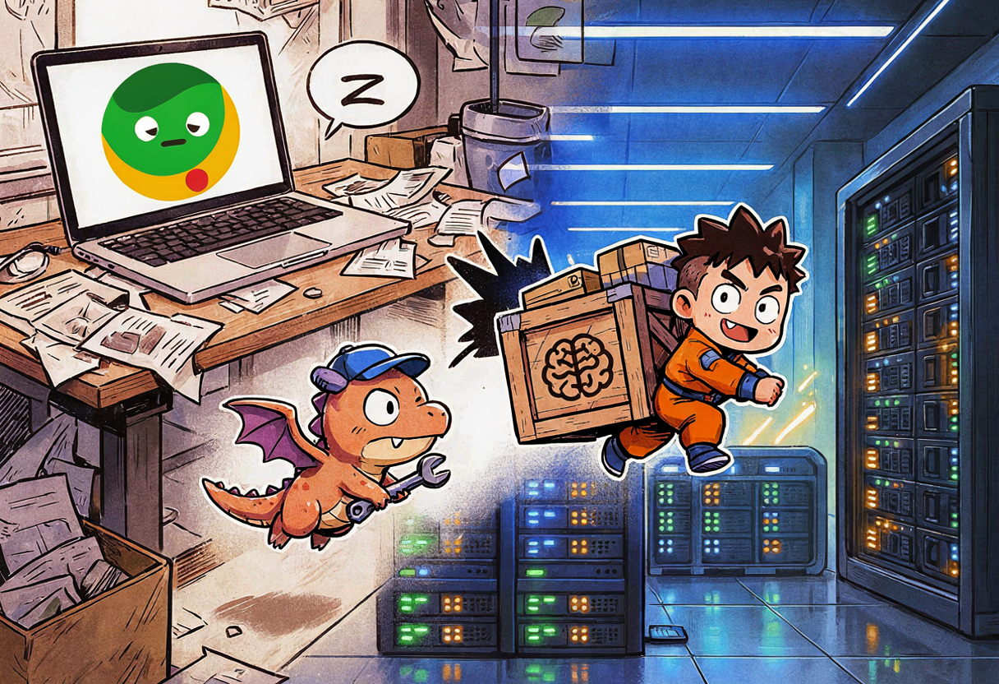
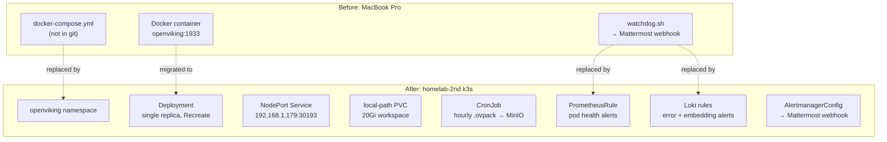

So OpenViking was running on my MacBook Pro as Docker container. It's the memory backend for my Hermes `andrzej` profile — the thing that stores and retrieves memories across sessions. And it was living on a laptop, bound to `0.0.0.0:1933`, with a shell script as its monitoring.

That's... not great 🤷

So I moved it into `homelab-2nd` k3s, where everything else lives. Flux-managed, SOPS-encrypted, backed up to MinIO, alerted through Loki and Alertmanager. The whole GitOps treatment.

## Why move it at all

OpenViking is only consumed by the local Hermes `andrzej` profile. No public DNS, no Cloudflare Tunnel, no external users. It's a personal memory database. So why bother?

Because running infrastructure on a laptop is fragile:

- **No GitOps.** The deployment config lives in a `docker-compose.yml` on the MacBook. Not in the repo. If the laptop dies, the config is gone.
- **No durable backups.** The data sits in a Docker volume on the laptop SSD. No scheduled backups, no offsite replication.
- **Local-only watchdog.** A shell script pings the health endpoint and posts to a Mattermost webhook. If the laptop sleeps, the watchdog sleeps too.
- **Laptop dependency.** If the MacBook reboots, OpenViking goes down. If Docker Desktop updates, OpenViking goes down. If I close the lid, OpenViking goes down.

The rest of the homelab runs on `homelab-2nd` k3s via Flux, with per-namespace observability and SOPS-encrypted secrets. OpenViking was the last holdout. Time to bring it home.

## What OpenViking actually is

Before the manifests, here is what OpenViking does:

- Memory backend — stores and retrieves memories for Hermes agent profiles
- Image: `ghcr.io/volcengine/openviking:latest` (pinned to digest `sha256:35384e355fc71b9c57871cf43b7779a8297b84cd3021a50f4efdc12a3c947279`, version `v0.3.24`)
- Runs on port 1933
- Health (`/health`) and readiness (`/ready`) endpoints
- No native Prometheus metrics (`/metrics` returns "Prometheus metrics are disabled")
- Embedded SQLite/vector store — no external database
- Embeddings via Ollama (`nomic-embed-text`), VLM via LiteLLM (`mistral-3.5-middle`)

The live workspace is tiny — about 32 KiB of metadata, plus the actual vector data in SQLite files. But that data is essential: it's months of accumulated memories.

## The plan

The decision is documented in [ADR-013](https://github.com/gulasz101/homelab-2nd/blob/main/docs/adr/adr-013-openviking-k3s-local-nodeport.md). Short version:

> Run OpenViking in a dedicated `openviking` namespace on `homelab-2nd` k3s. Expose it internally via a NodePort Service on `192.168.1.179:30193`. Store live workspace on a `local-path` PVC. Back up memory state hourly as an `.ovpack` to OMV MinIO. Route embeddings to the in-cluster Ollama GPU service. Route VLM calls to the in-cluster LiteLLM proxy. No Cloudflare Tunnel, no public DNS.



### Alternatives I rejected

| Option | Why rejected |
|---|---|
| Keep running on MacBook | No GitOps, no durable backups, local-only watchdog, laptop dependency |
| HelmRelease using upstream `examples/k8s-helm` | Upstream chart is a generic template, doesn't fit homelab patterns (SOPS, local-path + MinIO, per-namespace observability) |
| Public ingress via Cloudflare Tunnel | Unnecessary — only Hermes consumes it. Adds public attack surface for memory data |
| MetalLB LoadBalancer instead of NodePort | MetalLB not deployed in this cluster. NodePort is the existing pattern for local-only services (Honcho, Ollama embeddings) |
| CNPG Postgres for storage | OpenViking has its own embedded SQLite/vector store, doesn't support Postgres backend |

## The manifests

Here is every file, in the order Flux reconciles them. Copy-paste, adjust the namespace and IPs, done.

### 1. Namespace + PVC

The namespace uses `baseline` PodSecurity (not `restricted`) because the upstream image runs as root and we don't control its user/FS layout. The PVC is `local-path` — OpenViking is an in-memory-ish operational database, so if the node dies we restore from MinIO backup.

```yaml
# apps/openviking/namespace.yaml
apiVersion: v1
kind: Namespace
metadata:
  name: openviking
  labels:
    app.kubernetes.io/name: openviking
    pod-security.kubernetes.io/enforce: baseline
    pod-security.kubernetes.io/audit: baseline
    pod-security.kubernetes.io/warn: baseline
---
apiVersion: v1
kind: PersistentVolumeClaim
metadata:
  name: openviking-workspace
  namespace: openviking
spec:
  accessModes:
    - ReadWriteOnce
  storageClassName: local-path
  resources:
    requests:
      storage: 20Gi
```

20 GiB is generous headroom — the live workspace is ~32 KiB of metadata plus small SQLite/vector files.

### 2. Secrets (SOPS-encrypted)

Four secrets, all SOPS-encrypted with the homelab-2nd age key. The repo is public, so the plaintext never appears in any committed file:

- `openviking-root-api-key.sops.yaml` — key `root-api-key`
- `openviking-vlm-api-key.sops.yaml` — key `api-key`
- `openviking-mattermost-webhook-url.sops.yaml` — key `url`
- `openviking-minio-backup-creds.sops.yaml` — keys `ACCESS_KEY_ID`, `ACCESS_SECRET_KEY`

{: .prompt-warning }
The root API key is still the trivial `change-me-please` from the MacBook. It's internal-only, so it's not urgent, but there's a follow-up to rotate it to a strong key. Don't copy that habit. And I would never do it for production system of any client. At home I'm just granting myself privilege of being lazy from time to time.

### 3. Config — rendered by init container

The config is a JSON file (`ov.conf`) that needs secret values injected. The approach: an init container with busybox writes the config file with env var substitution. The ConfigMap below is kept as a stable reference but is no longer mounted into the pod — the init container renders the config inline.

```yaml
# apps/openviking/openviking-config-configmap.yaml
apiVersion: v1
kind: ConfigMap
metadata:
  name: openviking-config
  namespace: openviking
data:
  ov.conf: |
    {
      "server": {
        "host": "0.0.0.0",
        "port": 1933,
        "root_api_key": "${OPENVIKING_ROOT_API_KEY}"
      },
      "storage": {
        "workspace": "/app/.openviking/workspace"
      },
      "log": {
        "level": "INFO",
        "output": "stdout"
      },
      "embedding": {
        "dense": {
          "api_base": "http://ollama-embeddings.gpu-embedding.svc.cluster.local:11434/v1",
          "api_key": "local",
          "provider": "openai",
          "dimension": 768,
          "model": "nomic-embed-text"
        }
      },
      "vlm": {
        "api_base": "http://litellm.llm-hub.svc.cluster.local:4000/v1",
        "api_key": "${OPENVIKING_VLM_API_KEY}",
        "provider": "openai",
        "extra_headers": {
          "User-Agent": "OpenViking/1.0"
        },
        "model": "mistral-3.5-middle",
        "timeout": 3600,
        "max_concurrent": 64
      }
    }
```

What happens above? The embedding path points at the in-cluster Ollama GPU service (same one that backs docs-mcp-server and Honcho). The VLM path points at the in-cluster LiteLLM proxy (same one Honcho uses). No public endpoints — everything stays inside the cluster.

{: .prompt-info }
The embedding path switched from the MacBook's local `http://192.168.1.179:30114/v1` to the in-cluster service `http://ollama-embeddings.gpu-embedding.svc.cluster.local:11434/v1`. Same model, same endpoint, just routed through k8s DNS instead of a LAN IP.

### 4. Deployment

Single replica, `Recreate` strategy (single-node k3s, no rolling update needed). Image pinned to digest. Read-only root filesystem with emptyDir for `/tmp`. The init container renders `ov.conf` from the template above.

```yaml
# apps/openviking/openviking-deployment.yaml
apiVersion: apps/v1
kind: Deployment
metadata:
  name: openviking
  namespace: openviking
  labels:
    app.kubernetes.io/name: openviking
spec:
  replicas: 1
  strategy:
    type: Recreate
  selector:
    matchLabels:
      app.kubernetes.io/name: openviking
  template:
    metadata:
      labels:
        app.kubernetes.io/name: openviking
    spec:
      securityContext:
        runAsNonRoot: false
        fsGroup: 0
      initContainers:
        - name: render-config
          image: busybox:1.36
          command:
            - /bin/sh
            - -c
            - |
              set -e
              mkdir -p /app/.openviking
              cat > /app/.openviking/ov.conf <<EOF
              {
                "server": {
                  "host": "0.0.0.0",
                  "port": 1933,
                  "root_api_key": "${OPENVIKING_ROOT_API_KEY}"
                },
                "storage": {
                  "workspace": "/app/.openviking/workspace"
                },
                "log": {
                  "level": "INFO",
                  "output": "stdout"
                },
                "embedding": {
                  "dense": {
                    "api_base": "http://ollama-embeddings.gpu-embedding.svc.cluster.local:11434/v1",
                    "api_key": "local",
                    "provider": "openai",
                    "dimension": 768,
                    "model": "nomic-embed-text"
                  }
                },
                "vlm": {
                  "api_base": "http://litellm.llm-hub.svc.cluster.local:4000/v1",
                  "api_key": "${OPENVIKING_VLM_API_KEY}",
                  "provider": "openai",
                  "extra_headers": {
                    "User-Agent": "OpenViking/1.0"
                  },
                  "model": "mistral-3.5-middle",
                  "timeout": 3600,
                  "max_concurrent": 64
                }
              }
              EOF
          env:
            - name: OPENVIKING_ROOT_API_KEY
              valueFrom:
                secretKeyRef:
                  name: openviking-root-api-key
                  key: root-api-key
            - name: OPENVIKING_VLM_API_KEY
              valueFrom:
                secretKeyRef:
                  name: openviking-vlm-api-key
                  key: api-key
          volumeMounts:
            - name: config
              mountPath: /app/.openviking
      containers:
        - name: server
          image: ghcr.io/volcengine/openviking@sha256:35384e355fc71b9c57871cf43b7779a8297b84cd3021a50f4efdc12a3c947279
          imagePullPolicy: IfNotPresent
          ports:
            - name: http
              containerPort: 1933
              protocol: TCP
          env:
            - name: OPENVIKING_CONFIG_FILE
              value: /app/.openviking/ov.conf
          volumeMounts:
            - name: workspace
              mountPath: /app/.openviking/workspace
            - name: config
              mountPath: /app/.openviking
            - name: tmp
              mountPath: /tmp
          resources:
            requests:
              cpu: 25m
              memory: 256Mi
            limits:
              cpu: 500m
              memory: 1Gi
          livenessProbe:
            httpGet:
              path: /health
              port: http
            initialDelaySeconds: 15
            periodSeconds: 10
            timeoutSeconds: 5
            failureThreshold: 3
          readinessProbe:
            httpGet:
              path: /ready
              port: http
            initialDelaySeconds: 5
            periodSeconds: 5
            timeoutSeconds: 3
            failureThreshold: 3
          securityContext:
            allowPrivilegeEscalation: false
            readOnlyRootFilesystem: true
            capabilities:
              drop:
                - ALL
      volumes:
        - name: workspace
          persistentVolumeClaim:
            claimName: openviking-workspace
        - name: config
          emptyDir: {}
        - name: tmp
          emptyDir: {}
```

What happens above? The init container writes a JSON config file with the secret values expanded from env vars. The main container mounts the workspace PVC at `/app/.openviking/workspace` and the config emptyDir at `/app/.openviking` — the `ov.conf` lands in the emptyDir, the workspace is a separate sub-mount under it. Read-only root FS with emptyDir `/tmp` because the image runs as root and we drop all capabilities.

### 5. Service — LAN-only NodePort

No Cloudflare Tunnel, no public DNS. Just a NodePort on the node IP:

```yaml
# apps/openviking/openviking-service.yaml
apiVersion: v1
kind: Service
metadata:
  name: openviking
  namespace: openviking
spec:
  type: NodePort
  selector:
    app.kubernetes.io/name: openviking
  ports:
    - name: http
      port: 1933
      targetPort: 1933
      nodePort: 30193
```

Reachable inside the network on `192.168.1.179:30193`. Hermes on the MacBook points `ovcli.conf` at that address.

### 6. Backup CronJob — hourly to MinIO

The backup CronJob uses the OpenViking CLI (`ov backup`) inside the same image to create a `.ovpack` file, then uploads it to OMV MinIO. The image lacks `mc`, so the upload is done with a Python script using AWS SigV4 signing (MinIO requires SigV4, not Basic auth).

```yaml
# apps/openviking/openviking-backup-cronjob.yaml
apiVersion: batch/v1
kind: CronJob
metadata:
  name: openviking-backup
  namespace: openviking
spec:
  schedule: "0 * * * *"
  successfulJobsHistoryLimit: 3
  failedJobsHistoryLimit: 3
  concurrencyPolicy: Forbid
  jobTemplate:
    spec:
      template:
        spec:
          restartPolicy: OnFailure
          initContainers:
            - name: render-cli-config
              image: busybox:1.36
              command:
                - /bin/sh
                - -c
                - |
                  set -e
                  mkdir -p /root/.openviking
                  cat > /root/.openviking/ovcli.conf <<EOF
                  {
                    "url": "http://openviking.openviking.svc.cluster.local:1933",
                    "api_key": "${OPENVIKING_ROOT_API_KEY}",
                    "root_api_key": "${OPENVIKING_ROOT_API_KEY}",
                    "account": "homelab",
                    "user": "andrzej"
                  }
                  EOF
              env:
                - name: OPENVIKING_ROOT_API_KEY
                  valueFrom:
                    secretKeyRef:
                      name: openviking-root-api-key
                      key: root-api-key
              volumeMounts:
                - name: ovcli-config
                  mountPath: /root/.openviking
          containers:
            - name: backup
              image: ghcr.io/volcengine/openviking@sha256:35384e355fc71b9c57871cf43b7779a8297b84cd3021a50f4efdc12a3c947279
              imagePullPolicy: IfNotPresent
              command:
                - /bin/sh
                - -c
                - |
                  set -euo pipefail
                  TIMESTAMP=$(date +%Y%m%d-%H%M%S)
                  PACK=/tmp/openviking-${TIMESTAMP}.ovpack
                  echo "Starting OpenViking backup: ${PACK}"
                  /app/.venv/bin/ov language en
                  # Note: --include-vectors fails when the vector snapshot is incomplete.
                  # We backup the filesystem + memory data and rebuild vectors from the queue if needed.
                  /app/.venv/bin/ov backup "${PACK}" --account homelab --user andrzej
                  export BACKUP_PACK="${PACK}"
                  /app/.venv/bin/ov status --account homelab --user andrzej
                  ls -lh "${PACK}"
                  # Upload to MinIO using Python with AWS SigV4 signing (mc is not in the image)
                  /app/.venv/bin/python3 - <<'PY'
                  import os, sys, urllib.request, urllib.parse, hashlib, hmac, datetime, xml.etree.ElementTree as ET, base64, time
                  import http.client

                  bucket = 'cnpg-backups'
                  prefix = 'openviking/backups/'
                  endpoint = 'http://openmediavault.local:9000'
                  access_key = os.environ['OPENVIKING_MINIO_ACCESS_KEY']
                  secret_key = os.environ['OPENVIKING_MINIO_SECRET_KEY']
                  local_path = os.environ['BACKUP_PACK']
                  region = 'us-east-1'
                  service = 's3'

                  def sha256(data):
                      return hashlib.sha256(data if isinstance(data, bytes) else data.encode('utf-8')).hexdigest()

                  def sign(key, msg):
                      return hmac.new(key, msg.encode('utf-8'), hashlib.sha256).digest()

                  def get_signature_key(secret, date_stamp, region, service):
                      k_date = sign(('AWS4' + secret).encode('utf-8'), date_stamp)
                      k_region = sign(k_date, region)
                      k_service = sign(k_region, service)
                      return sign(k_service, 'aws4_request')

                  def signed_request(method, path, payload=b'', query=''):
                      t = datetime.datetime.now(datetime.timezone.utc)
                      date_stamp = t.strftime('%Y%m%d')
                      amz_date = t.strftime('%Y%m%dT%H%M%SZ')
                      if isinstance(payload, str):
                          payload = payload.encode('utf-8')
                      payload_hash = sha256(payload)
                      host = 'openmediavault.local:9000'
                      headers = {
                          'host': host,
                          'x-amz-content-sha256': payload_hash,
                          'x-amz-date': amz_date,
                      }
                      if method in ('PUT', 'POST'):
                          headers['content-length'] = str(len(payload))
                      header_keys = sorted(headers.keys())
                      signed_headers = ';'.join(header_keys)
                      canonical_request = '\n'.join([
                          method,
                          urllib.parse.quote(path, safe='/'),
                          query,
                          ''.join(f'{k}:{headers[k]}\n' for k in header_keys),
                          signed_headers,
                          payload_hash,
                      ])
                      credential_scope = f'{date_stamp}/{region}/{service}/aws4_request'
                      string_to_sign = '\n'.join([
                          'AWS4-HMAC-SHA256',
                          amz_date,
                          credential_scope,
                          sha256(canonical_request.encode('utf-8')),
                      ])
                      signing_key = get_signature_key(secret_key, date_stamp, region, service)
                      signature = hmac.new(signing_key, string_to_sign.encode('utf-8'), hashlib.sha256).hexdigest()
                      auth_header = f'AWS4-HMAC-SHA256 Credential={access_key}/{credential_scope}, SignedHeaders={signed_headers}, Signature={signature}'
                      headers['Authorization'] = auth_header
                      url = f'{endpoint}{path}'
                      if query:
                          url = f'{url}?{query}'
                      req = urllib.request.Request(url, data=payload, method=method, headers=headers)
                      return urllib.request.urlopen(req, timeout=120)

                  object_key = prefix + os.path.basename(local_path)
                  data = open(local_path, 'rb').read()
                  encoded_key = urllib.parse.quote(object_key, safe='/')

                  for attempt in range(3):
                      try:
                          resp = signed_request('PUT', f'/{bucket}/{encoded_key}', data)
                          print(f'Uploaded {local_path} -> {bucket}/{object_key} (HTTP {resp.status})')
                          break
                      except Exception as e:
                          print(f'Upload attempt {attempt + 1} failed: {e}')
                          if attempt == 2:
                              raise
                          time.sleep(2 ** attempt)

                  # List and delete objects older than 7 days
                  list_query = urllib.parse.urlencode(
                      {'list-type': '2', 'prefix': prefix},
                      quote_via=urllib.parse.quote,
                  )
                  list_resp = signed_request('GET', f'/{bucket}', b'', list_query)
                  root = ET.fromstring(list_resp.read())
                  ns = {'s3': 'http://s3.amazonaws.com/doc/2006-03-01/'}
                  cutoff = datetime.datetime.now(datetime.timezone.utc) - datetime.timedelta(days=7)
                  removed = 0
                  for contents in root.findall('s3:Contents', ns):
                      key_el = contents.find('s3:Key', ns)
                      if key_el is None:
                          continue
                      key = key_el.text
                      last_mod = datetime.datetime.fromisoformat(contents.find('s3:LastModified', ns).text.replace('Z', '+00:00'))
                      if last_mod < cutoff:
                          signed_request('DELETE', f'/{bucket}/{urllib.parse.quote(key, safe="/")}')
                          removed += 1
                          print(f'Removed old backup: {key}')
                  print(f'Retention cleanup complete, removed {removed} objects')
                  PY
                  echo "Backup complete: ${PACK}"
              env:
                - name: OPENVIKING_CLI_CONFIG_FILE
                  value: /root/.openviking/ovcli.conf
                - name: HOME
                  value: /root
                - name: OPENVIKING_MINIO_ACCESS_KEY
                  valueFrom:
                    secretKeyRef:
                      name: openviking-minio-backup-creds
                      key: ACCESS_KEY_ID
                - name: OPENVIKING_MINIO_SECRET_KEY
                  valueFrom:
                    secretKeyRef:
                      name: openviking-minio-backup-creds
                      key: ACCESS_SECRET_KEY
                - name: BACKUP_PACK
                  value: /tmp/openviking-OVPACK_PLACEHOLDER.ovpack
              volumeMounts:
                - name: ovcli-config
                  mountPath: /root/.openviking
                - name: tmp
                  mountPath: /tmp
                - name: data
                  mountPath: /data
          volumes:
            - name: ovcli-config
              emptyDir: {}
            - name: tmp
              emptyDir: {}
            - name: data
              persistentVolumeClaim:
                claimName: openviking-workspace
```

Every hour, a backup lands in MinIO under `cnpg-backups/openviking/backups/`. Retention: 7 days (168 backups). Memory data is essential — frequent backups are the durability layer.

{: .prompt-warning }
This CronJob went through multiple bugs before it worked. The init container originally used `$(VAR)` (command substitution) instead of `${VAR}` and wrote empty API keys. The backup container needed `OPENVIKING_CLI_CONFIG_FILE` and `HOME` env vars. The image lacks `mc`, so I replaced it with Python `urllib`. MinIO requires AWS SigV4, not Basic auth. And `--include-vectors` fails on an incomplete snapshot, so it was removed from the backup command. All of that is already baked into the manifest above.

### 7. Observability — replacing the shell script watchdog

The old MacBook watchdog was a shell script that checked health, embedding model list, and embedding inference, then posted to a Mattermost webhook. After migration, this is replaced by proper k8s observability.

#### Prometheus pod-health alerts

```yaml
# apps/openviking/openviking-prometheus-rules.yaml
apiVersion: monitoring.coreos.com/v1
kind: PrometheusRule
metadata:
  name: openviking-resource-alerts
  namespace: openviking
  labels:
    release: prometheus-stack
spec:
  groups:
    - name: openviking.resources
      interval: 1m
      rules:
        - alert: OpenVikingCPUAboveRequest
          expr: |
            sum by (pod, container, namespace) (
              rate(container_cpu_usage_seconds_total{namespace="openviking", container!=""}[5m])
            )
            >
            sum by (pod, container, namespace) (
              kube_pod_container_resource_requests{namespace="openviking", resource="cpu", container!=""}
            )
          for: 5m
          labels:
            severity: warning
            namespace: openviking
          annotations:
            summary: "openviking/{{ $labels.pod }} CPU above request"
            description: "{{ $labels.pod }}/{{ $labels.container }} CPU usage exceeds its request for more than 5 minutes."

        - alert: OpenVikingMemoryAboveRequest
          expr: |
            sum by (pod, container, namespace) (
              container_memory_working_set_bytes{namespace="openviking", container!=""}
            )
            >
            sum by (pod, container, namespace) (
              kube_pod_container_resource_requests{namespace="openviking", resource="memory", container!=""}
            )
          for: 5m
          labels:
            severity: warning
            namespace: openviking
          annotations:
            summary: "openviking/{{ $labels.pod }} memory above request"
            description: "{{ $labels.pod }}/{{ $labels.container }} memory usage exceeds its request for more than 5 minutes."

        - alert: OpenVikingCPUAbove90PercentLimit
          expr: |
            100 * sum by (pod, container, namespace) (
              rate(container_cpu_usage_seconds_total{namespace="openviking", container!=""}[5m])
            )
            /
            sum by (pod, container, namespace) (
              container_spec_cpu_quota{namespace="openviking", container!=""} / container_spec_cpu_period{namespace="openviking", container!=""}
            ) > 90
          for: 5m
          labels:
            severity: critical
            namespace: openviking
          annotations:
            summary: "openviking/{{ $labels.pod }} CPU above 90% of limit"
            description: "{{ $labels.pod }}/{{ $labels.container }} CPU is above 90% of its limit for more than 5 minutes."

        - alert: OpenVikingMemoryAbove90PercentLimit
          expr: |
            100 * sum by (pod, container, namespace) (
              container_memory_working_set_bytes{namespace="openviking", container!=""}
            )
            /
            sum by (pod, container, namespace) (
              kube_pod_container_resource_limits{namespace="openviking", resource="memory", container!=""}
            ) > 90
          for: 5m
          labels:
            severity: critical
            namespace: openviking
          annotations:
            summary: "openviking/{{ $labels.pod }} memory above 90% of limit"
            description: "{{ $labels.pod }}/{{ $labels.container }} memory is above 90% of its limit for more than 5 minutes."

        - alert: OpenVikingPodNotReady
          expr: |
            kube_pod_status_ready{namespace="openviking", pod=~"openviking.*"} != 1
          for: 3m
          labels:
            severity: critical
            namespace: openviking
          annotations:
            summary: "openviking/{{ $labels.pod }} is not ready"
            description: "The OpenViking pod has been not ready for more than 3 minutes."

        - alert: OpenVikingContainerRestarting
          expr: |
            rate(kube_pod_container_status_restarts_total{namespace="openviking", container="server"}[15m]) > 0
          for: 0m
          labels:
            severity: warning
            namespace: openviking
          annotations:
            summary: "openviking/{{ $labels.pod }} container is restarting"
            description: "The OpenViking container has restarted in the last 15 minutes."
```

#### Loki log-based alerts

These are the direct replacements for the old watchdog's health and embedding checks:

```yaml
# apps/openviking/openviking-loki-rule.yaml
apiVersion: v1
kind: ConfigMap
metadata:
  name: openviking-loki-rules
  namespace: observability
  labels:
    loki_rule: "true"
data:
  openviking-errors.yaml: |
    groups:
      - name: openviking.errors
        interval: 1m
        rules:
          - alert: OpenVikingErrorsOrCrashes
            expr: |
              sum by (pod, namespace) (
                count_over_time(
                  {k8s_namespace_name="openviking"}
                    |~ "Error|ERROR|ERR|FATAL|fatal|Traceback|ConnectTimeout|APITimeoutError|UNHEALTHY|unhealthy"
                  [5m]
                )
              ) > 0
            for: 2m
            labels:
              severity: warning
              namespace: openviking
            annotations:
              summary: "openviking logged errors or crashes"
              description: "{{ $labels.pod }} in namespace {{ $labels.namespace }} logged errors within the last 5 minutes."

          - alert: OpenVikingEmbeddingFailures
            expr: |
              sum by (pod, namespace) (
                count_over_time(
                  {k8s_namespace_name="openviking"}
                    |~ "embedding|embeddings|nomic-embed-text|ConnectTimeout|APITimeoutError|connection|timeout"
                  [5m]
                )
              ) > 0
            for: 3m
            labels:
              severity: warning
              namespace: openviking
            annotations:
              summary: "openviking embedding endpoint may be failing"
              description: "{{ $labels.pod }} in namespace {{ $labels.namespace }} logged embedding-related failures in the last 5 minutes."
```

#### Alertmanager routing to Mattermost

```yaml
# apps/openviking/openviking-alertmanager-config.yaml
apiVersion: monitoring.coreos.com/v1alpha1
kind: AlertmanagerConfig
metadata:
  name: openviking-mattermost-alerts
  namespace: openviking
  labels:
    release: kube-prometheus-stack
spec:
  route:
    receiver: openviking-mattermost
    matchers:
      - name: namespace
        value: openviking
        matchType: "="
  receivers:
    - name: openviking-mattermost
      webhookConfigs:
        - urlSecret:
            name: openviking-mattermost-webhook-url
            key: url
          sendResolved: true
          maxAlerts: 10
```


What happens above? Three layers of monitoring replace the old shell script: Kubernetes probes (liveness/readiness), Prometheus rules (pod health + resource usage), and Loki rules (log-based error and embedding failure detection). All routed through Alertmanager to the same Mattermost channel as the old watchdog — but now it works even when the laptop is asleep.

{: .prompt-warning }
No ServiceMonitor / PodMonitor. OpenViking has no `/metrics` endpoint — metrics are skipped per Supreme Leader decision. The dashboard shows pod resource usage + logs only.

### 8. Wire it into kustomization

Add the block to `apps/kustomization.yaml`:

```yaml
  # OpenViking namespace (local-only memory backend)
  - openviking/namespace.yaml
  # SOPS-encrypted secrets
  - openviking/openviking-root-api-key.sops.yaml
  - openviking/openviking-vlm-api-key.sops.yaml
  - openviking/openviking-mattermost-webhook-url.sops.yaml
  - openviking/openviking-minio-backup-creds.sops.yaml
  # PVC + config + deployment + service
  - openviking/openviking-config-configmap.yaml
  - openviking/openviking-deployment.yaml
  - openviking/openviking-service.yaml
  # Backup
  - openviking/openviking-backup-cronjob.yaml
  # Observability
  - openviking/openviking-prometheus-rules.yaml
  - openviking/openviking-alertmanager-config.yaml
  - openviking/openviking-loki-rule.yaml
  - openviking/openviking-dashboard-configmap.yaml
```

Commit, push, wait for Flux reconciliation.

## The cutover


The migration was executed on 2026-08-15. Here's what actually happened:

1. **MacBook container stopped** at ~22:30 CEST
2. **Andrzej profile `.env` updated**: `OPENVIKING_ENDPOINT=http://192.168.1.179:30193`, API key regenerated for the k3s instance
3. **Andrzej profile `config.yaml` updated**: `memory.openviking.use_ovcli_config: true`
4. **`~/.openviking/ovcli.conf` updated** to point at k3s NodePort
5. **Hermes gateway restarted** — live `viking_search` and `viking_remember` now hit k3s

### The gotcha that almost killed it

The old `.env` still pointed at `127.0.0.1:1933`. `.env` env vars override `ovcli.conf`. So even after updating `ovcli.conf` to point at the k3s NodePort, Hermes was still trying to connect to the local Docker container — which was now stopped. "OpenViking server not connected" 😅

Also: the MacBook's user API key is instance-scoped. It does not work on k3s. Had to recreate the `homelab` account + `andrzej` user + regenerate a key on the new instance.

{: .prompt-danger }
User API keys in OpenViking are instance-scoped — they do not survive a migration. You must recreate the account and user on the new instance and generate a new key. This is not documented anywhere obvious.

### Verification

```bash
curl http://192.168.1.179:30193/health   # → 200
curl http://192.168.1.179:30193/ready    # → ready
```

- `ov status` from inside the cluster shows 1329 vectors rebuilt after restore, 0 pending
- A Hermes memory search returns expected results through the new endpoint
- `viking_remember` writes successfully to the new endpoint

The old MacBook Docker container is stopped but its data remains. 24-hour rollback window: `docker start openviking` + reverting `ovcli.conf` to `127.0.0.1:1933` would restore the old path.

## What I learned

- **`.env` overrides `ovcli.conf`.** Always check both when migrating endpoints. The `.env` file was still pointing at the old local address and silently overriding the new config.
- **User API keys are instance-scoped.** This is not documented. Budget time for recreating accounts and users on the new instance.
- **The per-namespace observability template works.** Copy the Prometheus rules, Loki rules, AlertmanagerConfig, and dashboard ConfigMap from the `voice`/`honcho` template, change the namespace label, done. The pattern scales.
- **`local-path` + MinIO backup is the right tradeoff.** Fast local storage for the live workspace, hourly offsite backups for durability. If the node dies, we lose at most one hour of memory writes.

## What's next

- Grafana dashboard for `openviking` needs to show up in the UI (dashboard ConfigMap deployed, waiting for Grafana sidecar pickup)
- Verify first `.ovpack` backup appears in MinIO under `openviking/backups/`
- After 24-hour smoke test passes: `docker rm openviking` and archive the old MacBook configs
- The old watchdog Hermes cron job (`openviking-embedding-watchdog`, ID `331ef9caaf01`) has been removed — the PrometheusRules + Alertmanager config now own health/embedding alerting

>Material for this post, and some parts of the post are AI assisted.
Models used while working on migration and post itself:
- kimi-k2.7 (ollama cloud)
- glm5.2 (ollama cloud)
- deepseek-v4-flash-0731 (ollama cloud)
- deepseek-v4-pro-ollama (ollama cloud)
- ideogram4 (self hosted)
	- unsloth/Qwen3-VL-8B-Instruct-GGUF (self hosted)
	- HauhauCS/Qwen3VL-8B-Uncensored-HauhauCS-Aggressive-Q4_K_M.gguf (self hosted)
- HauhauCS/Gemma4-12B-QAT-Uncensored-HauhauCS-Balanced-Q4_K_M.gguf (self hosted)
