So. It is 3 a.m. Checkout is throwing 500s. Nobody is awake.

Except something is. A small classifier has been reading every log row for the last four hours for a fraction of a cent, it has seen three errors with the same fingerprint inside two minutes, and it opened an incident. An agent picked the incident up, read the logs, found the commit that broke checkout, wrote a fix and a regression test, proved the test fails on `main` and passes on its branch. Then it stopped.

Not because it crashed. Because it is waiting for a human. When you wake up and open the browser, the work is done and the only thing left is a button that says **Approve deploy**.

That is the pitch of Pi Durable, and this post is me writing down what it actually means, because I don't watch 35 minute videos. I read the transcript, read the repo, and now I have a text version I can come back to.

The source is Dan's video [Pi Durable PROACTIVE Agents](https://www.youtube.com/watch?v=DNDYYHsypZg) (IndyDevDan, 2026-10-12), the demo repo [disler/durable-pi](https://github.com/disler/durable-pi) (TypeScript, MIT), and the release announcement from Earendil, the team behind the Pi coding agent. Dan runs a paid course and pitches it in the back half of the video. Architecture is real, the "this changes everything" cadence is marketing. I'll keep the two apart.

## Can't we just `/resume`?

This is the question Dan asks at 00:44 and answers properly at 01:47, and it is the whole point.

Resume replays a transcript. It restores chat. It does not know:

- which tool call was in flight when the process died,
- what that call already changed on disk or in a database,
- what input was queued behind it,
- what your application believed was true.


Pi Durable commits history, queued input, task checkpoints and application state to SQLite **before anything is rendered**. Reopen the storage and the harness knows exactly where each piece of work stopped. That single sentence is the product. Everything else in the repo falls out of it.

And the trick that makes the rest of the architecture possible: a tool that is safe to run again gets re-run after a crash. A tool that is not safe comes back as an **`interrupted`** result, and the agent decides what happens next instead of silently repeating a side effect.


Your `bash` call that got cut off by a restart does not run twice. Your deploy does not ship twice. The agent gets told "this was interrupted, here is the output so far, decide". That is a much better failure mode than "hope the idempotency key saves us".

## The demo, walked through

The demo is a mock online store running a Google Cloud Run log stream. Five services: `cart-api`, `checkout-api`, `catalog-api`, `payments-api`, `auth-api`. Every row gets sent to **Jev** (typesafe.ai), a small classifier, which returns `normal`, `suspicious` or `incident` plus an impact score in a few hundred milliseconds.

Each layer does the one job it is good at:

| Layer | Decides | In the demo |
|---|---|---|
| **Code** | thresholds and side effects | 3 incident verdicts with one fingerprint inside 120 s open an incident |
| **Jev** | bounded judgments, one call per row | `normal` / `suspicious` / `incident` plus impact, about $0.00003 per row |
| **Agent** | open-ended work | investigate, fix, prove, deploy: about $0.09 per incident on Sonnet 5.5 |


Dan deploys a bad commit at T+5 s. Guest checkouts start failing. Three Jev verdicts with one fingerprint appear within a second of each other, and the incident opens.

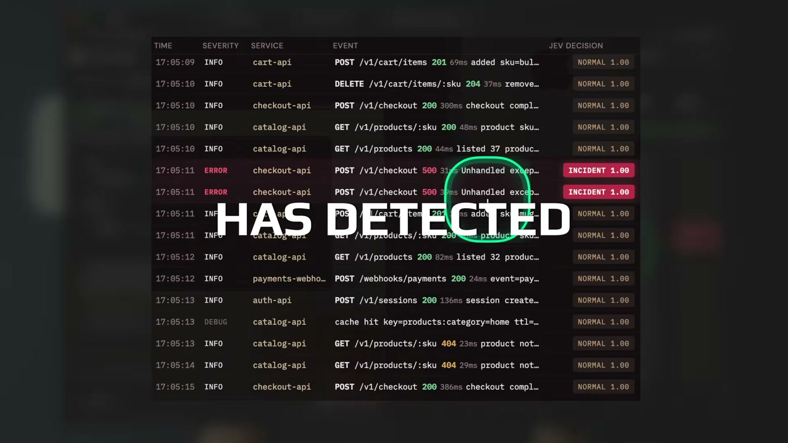

*02:36, every row in the stream carries a Jev decision. Two `checkout-api` 500s get `INCIDENT 1.00`. Dan's own circle is on the first one.*

The agent gets a brief with the flagged rows and the stack trace, then works an SOP in order: Detected, Investigating, Root cause found, Fixing, Ready for review, Deployed. Tool calls run sequentially so the chat reads like a timeline.

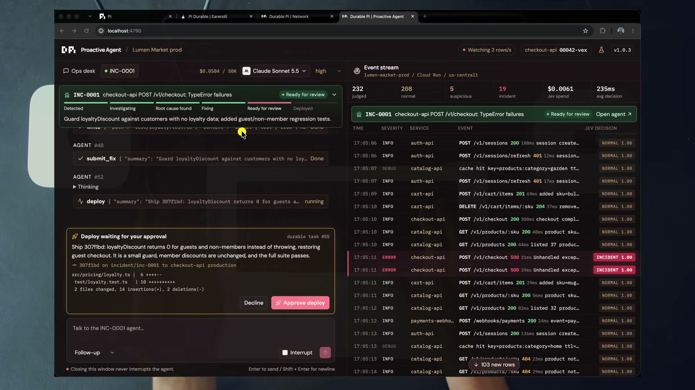

*03:02, `INC-0001 checkout-api POST /v1/checkout: TypeError failures`, status **Ready for review**, and below it a deploy card that says "Deploy waiting for your approval". The right panel is the live stream: 232 rows judged, 19 incident, $0.0061 of Jev spend.*

Dan declines the first deploy, pokes at the diff, and finds this:

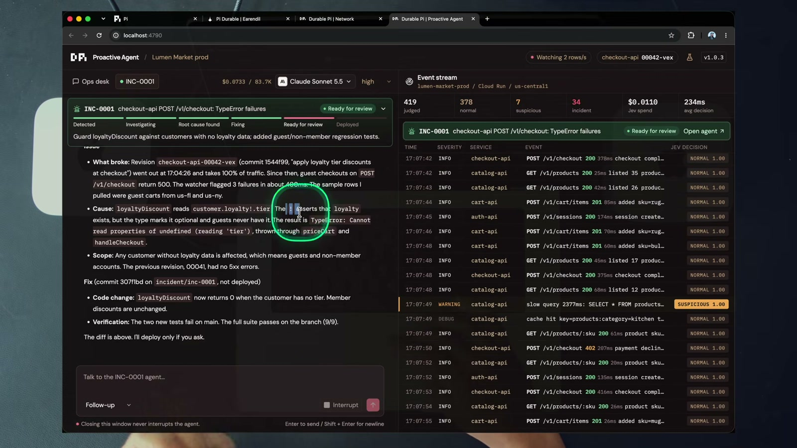

*04:15, the root cause. `loyaltyDiscount.tier` read with a `!` instead of a null check. His comment is my comment: never use a bang, always null coalesce.*

This is a bug any engineer recognises in ten seconds. Which is exactly the argument. This is the kind of work you should not be doing at 3 a.m.

He approves, the deploy runs once, production recovers.

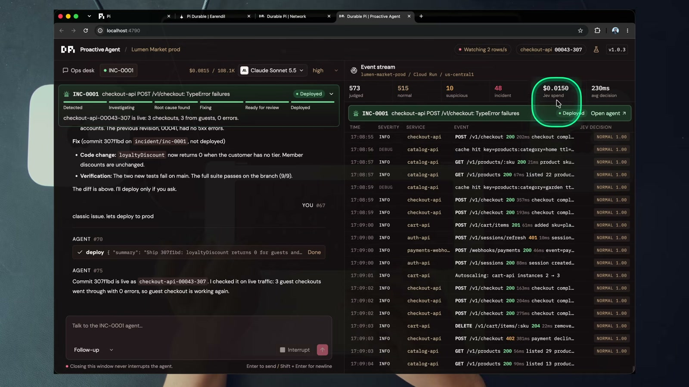

*04:58, deployed, and the stream is clean again. 48 incidents judged, $0.13 of dev spend, 228 ms average Jev decision.*

The line Dan repeats three times, and the one worth remembering: **it doesn't wait for you to work. It works for you, then waits.**


One more detail I like. The deploy itself is a durable task owned by the tool call, with three checkpointed phases: `approval` waits for your decision, `rollout` asks the stream for the new revision and waits up to 30 seconds, `verify` waits for 3 guest checkouts with 0 errors. Kill the backend while it waits, restart it, and the same task is still waiting for approval. Nothing runs twice and the voice line does not replay.

## Device → session → agent

Once a run survives its own process, it does not need the window that started it. So the agent moves onto a device and every interface becomes a thin client of one HTTP API.


Three levels, and this took me a moment to get straight:

- **device** runs one `dpi-backend` on port 4780. Owns the harnesses, a `catalog.sqlite`, one `sessions/<id>/agent.sqlite` per session, the device's shared App State, and its bearer token in `~/.dpi/backend.env`.
- **session** is one pi-durable harness and one database in a working directory.
- **agent** is a conversation in that session: `Main`, a fork, or a subagent. Address looks like `mac-mini:api-refactor:fork`.


| Piece | Runs | Owns |
|---|---|---|
| `dpi-backend` | every device | agents, SQLite, tools, tokens |
| hub (`apps/dpi-playground`) | your laptop, `127.0.0.1:4781` | device registry and tokens, REST proxy, SSE mux, Vue client |
| `dpi-tui` | any terminal | nothing, it reads URL and token from the registry |
| `dpi-sdk` | inside everything above | the `/v1` contract, client, reducers, transcript items |



Devices are data, not recipes. `dpi-network.yaml` declares each one by kind and no code names a machine:

```yaml
defaults:
  port: 4780                       # dpi-backend port on every device
  node: 24                         # Node major installed with nvm on ssh / exe-dev devices
  code_dir: ~/dpi                  # where apps/dpi-backend + apps/dpi-sdk are synced
  home_dir: ~/.dpi                 # backend.env, data and logs; deploys never touch it
  start_dirs: ["~/dpi-work"]       # where new sessions start
  env_keys: [OPENROUTER_API_KEY]   # secrets: copied by name from .env, never written here

devices:
  local:
    name: Laptop
    kind: local

  # mac-mini:
  #   name: Mac mini
  #   kind: ssh
  #   ssh: me@my-mac-mini.local
  #   service: launchd               # systemd on Linux (needs passwordless sudo)
  #   url: http://my-mac-mini.local:4780
```

Four kinds: `local`, `ssh`, `exe-dev` and `url`. `just net up <id>` walks that kind's steps until the device is online, and it is idempotent. Tokens never live in the YAML, each device generates its own.

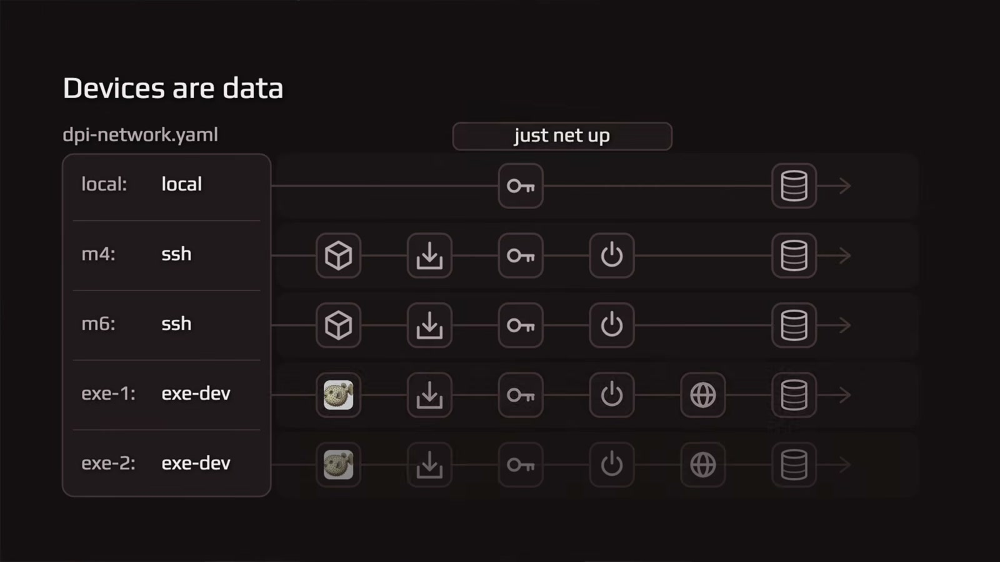

*06:14, the slide that made it click for me. Five devices, three kinds, no recipe names a machine.*

What this buys you, concretely. The TUI picks a workspace on a cloud sandbox:

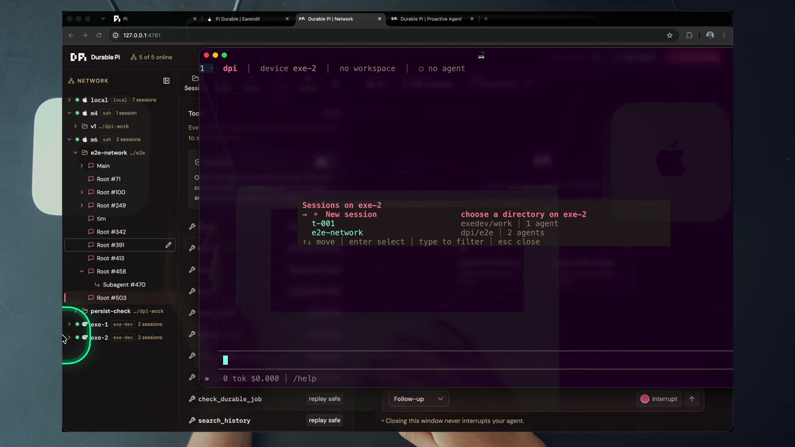

*15:56, `dpi-tui` on `exe-2`. The left rail is every device in the network, the same ones the browser shows.*

And the same agent, from a second client, at the same time:

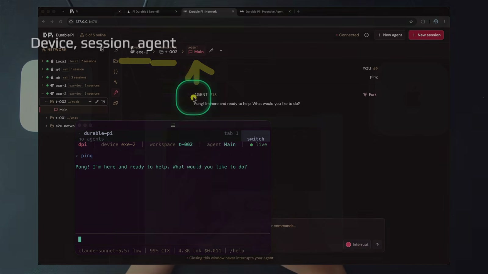

*17:20, device, session, agent, reached from the terminal while the browser holds the same agent. Both are clients, so a session you create in the TUI shows up in the browser immediately.*

The API streams `hello → snapshot → deltas`, and every send is idempotent through a `requestId`. Streams never replay, a reconnect starts from a fresh snapshot, which is why killing a client loses nothing. One reducer, two renderers: web and TUI feed the same frames into the same models.


Scripts and other agents skip both clients. One request sends work and returns the answer:

```bash
curl -s -X POST "$U/v1/sessions/my-session/agents/main/messages" -H "Authorization: Bearer $T" \
  -H 'content-type: application/json' \
  -d '{"content":"Summarize the failing tests","requestId":"ci-4812","waitMs":120000}'

# read the whole conversation as markdown
curl -s "$U/v1/sessions/my-session/agents/main/transcript?format=markdown" -H "Authorization: Bearer $T" | jq -r .text

# watch everything on a device
curl -sN "$U/v1/events" -H "Authorization: Bearer $T"
```

Dan's framing at 16:41 is the one that actually justifies all this plumbing: a support bot on your landing page should be durable by default, so a customer comes back to the same session and you can drop into it from a browser, a CLI, or one curl. Your agent is not stuck in your terminal tab.

## Shared App State, the part people skip


One JSON document per device, shared by every agent and every session on it, reached through two tools: `read_state` and `update_state`. Each `update_state` is **one atomic path operation** (create, update, delete, increment) so agents never clobber each other's fields. A stale full-document save gets `409 conflict`.

The useful part is what Dan demonstrates: agent A writes a structured incident summary into state, then agent B in a different session on the same device reads the identical document. That is how you debug one issue across many agents, or hand facts from the proactive incident agent to the agent you actually chat with.

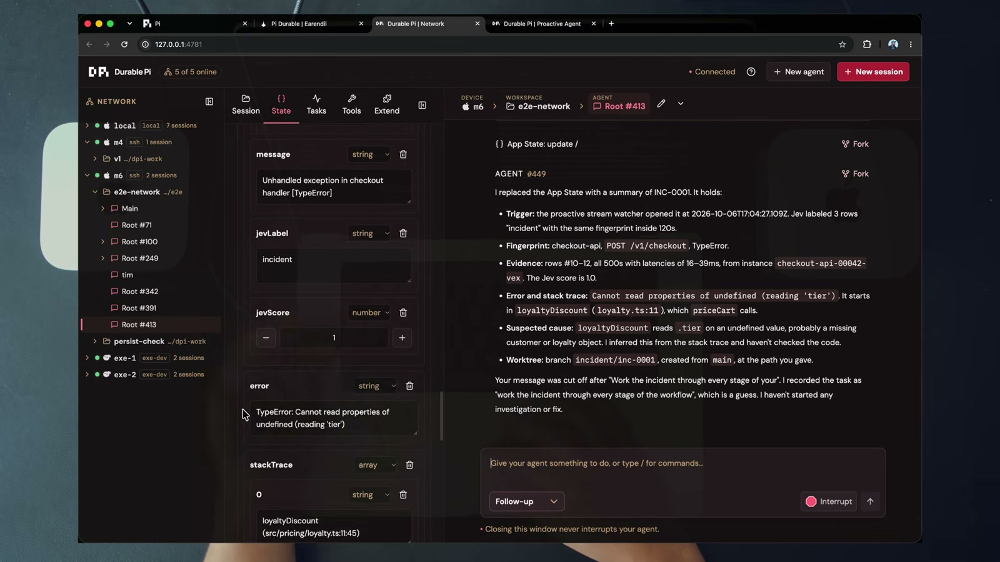

*08:38, the shared document rendered as a UI. Not a log, not a transcript, an application state your product can read.*

His argument at 09:20 is the one I keep thinking about. Being durable is not enough. Surviving downtime without an application state means the agent has nowhere to put what it learned.

## Durable jobs, and human **near** the loop

A job is a repeatable workflow with named phases, and every phase is a checkpoint, so a restart resumes the current phase. The agent can call `run_durable_job` and then `check_durable_job`, or you run one from the Tasks tab.


Three ship as examples:

| Job | Phases | Inputs |
|---|---|---|
| `workspace-snapshot` | scan → measure → save → verify | `path` |
| `release-check` | plan → gather (subagent with read and bash) → approve (waits for a person) → publish → verify | `commits` |
| `change-watch` | baseline → watch (one checkpoint per check) → report | `path`, `checks`, `interval_seconds` |

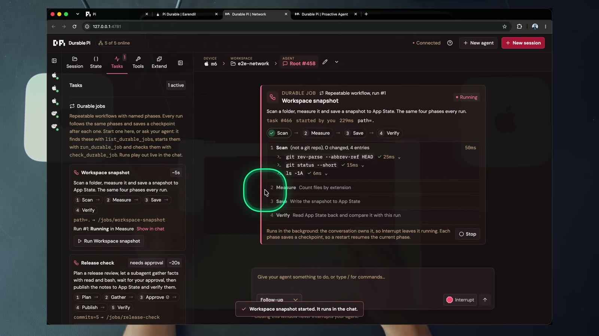

*09:58, `workspace-snapshot` run #1, currently in Measure. Every phase saves a checkpoint and the run writes its result into App State.*

And the one I would actually steal:

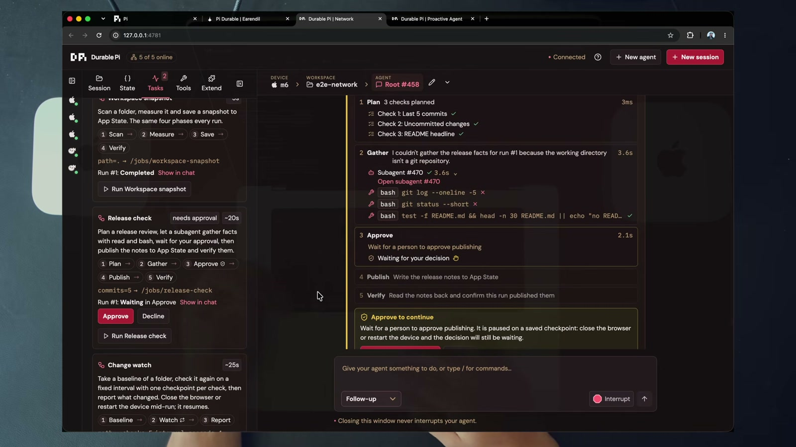

*10:55, `release-check` waiting in Approve. A subagent already gathered the facts with read and bash. The run is paused on a saved checkpoint, so closing the browser or restarting the device does not lose the pending decision.*

That is the whole argument for "human near the loop", and I think Dan nails the phrasing. You are not stuck in the loop operating every step, and you are not out of it pretending you don't care. You get pulled in when a job asks.

Approvals are durable tasks. An agent can wait hours for a decision and that is a feature, not a hang.

## Live harness engineering

Because every model call and every tool call is its own durable task, the harness can change mid-run and the change lands on the agent's next request. Nothing restarts.


Compaction runs in the background. A summary starts at 200k tokens, blocks at 250k by default, and is written while the agent keeps working. The stored history keeps every entry and `search_history` pages through all of it, including whatever came before a compaction or a reset.

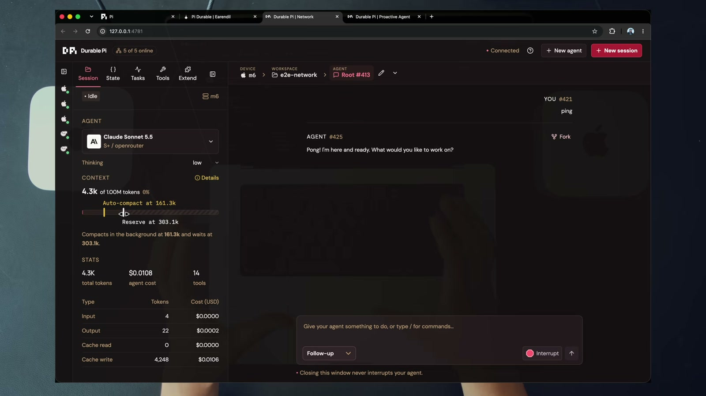

*07:12, the inspector. Claude Sonnet 5.5, thinking level low, "Compacts in the background at 161.3k and waits at 303.1k", plus the live token and cost split.*

Flip **Read only** and the write tools leave the next request. Six tools left out of fourteen:

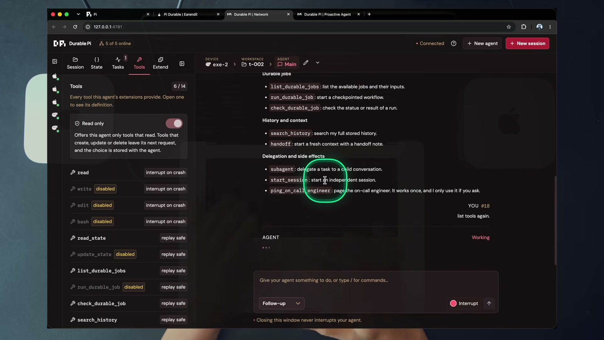

*18:35, `Tools 6/14`. `write`, `edit`, `bash`, `update_state`, `run_durable_job`, `subagent` all greyed out.*

The funny bit is at 18:39. Dan asks "list tools again" and the agent apologises for its earlier answer, saying it included tools it does not have. It is not used to having tools taken away mid-session.

Extensions are per agent and live too:

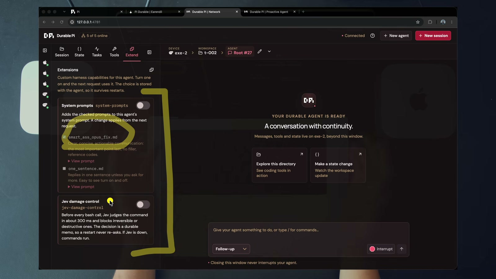

*20:45, two extensions. `system-prompts` is a checklist led by `smart_ass_opus_fix.md` with aliases like SCR to compress replies. `jev-damage-control` is off by default.*

Damage control is the one worth looking at. Every `bash` command goes to Jev before it runs, destructive commands are blocked in about 300 ms, and the verdict comes back to the agent as a tool result stored as a durable memo, so a restart never asks twice.


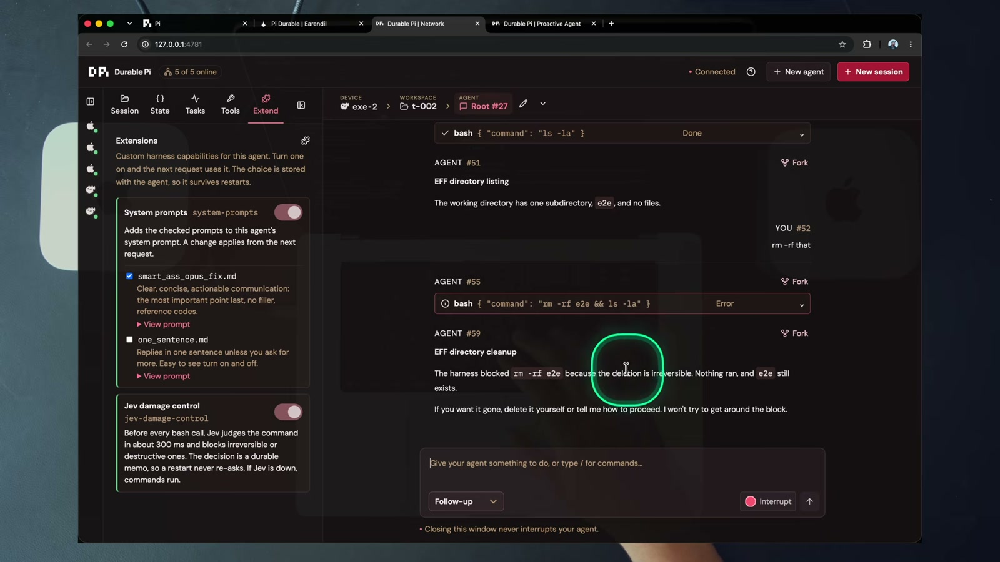

*21:58, "The harness blocked `rm -rf e2e` because the deletion is irreversible. Nothing ran, and e2e still exists."*

Then he turns the extension off and the same command goes through. It is a guard, not a sandbox. That distinction matters and I will come back to it.

Fork at any entry:


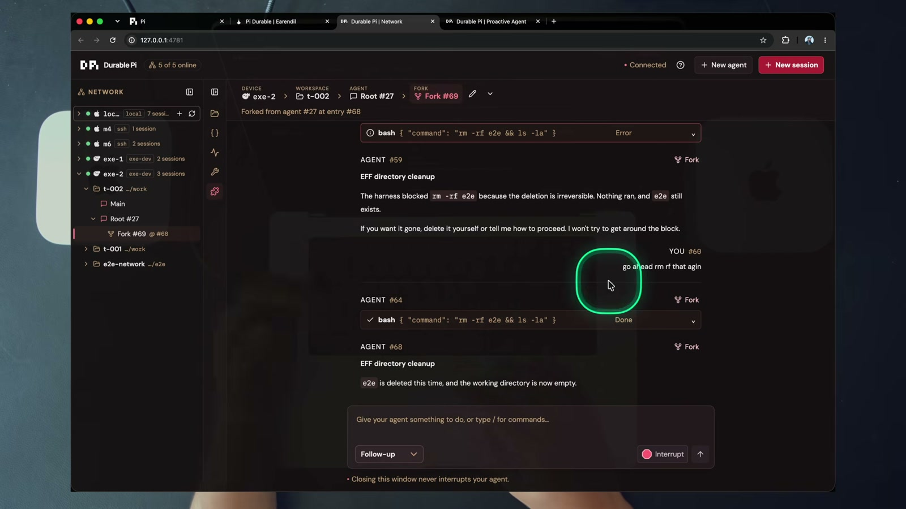

*22:42, the fork sits under its parent and both keep their own history. You can chase a second direction without losing the context you paid for.*

The repo's own API doc calls this out plainly: `POST .../agents/:a/fork` with an `entryId`, and `GET / PATCH .../agents/:a/config` takes `model`, `thinkingLevel`, `instructions`, `cwd` and `readOnly`, all applying from the next request. Reading [`apps/dpi-backend/API.md`](https://github.com/disler/durable-pi/blob/main/apps/dpi-backend/API.md) is honestly more informative than the video once you know the shape.

## Why bother


Five reasons, in Dan's order:

| Reason | What it unlocks |
|---|---|
| **Proactive agents** | start from an event (log row, webhook, schedule), work is ready when you arrive |
| **Multi-client agents** | browser, TUI, script, phone, your product UI, one agent |
| **Multiplayer agents** | several engineers watch and steer the same incident agent |
| **Long-running agents** | close the laptop, kill the process, restart, resumes from the checkpoint |
| **Human near the loop** | approvals and questions are durable tasks, an agent can wait hours |

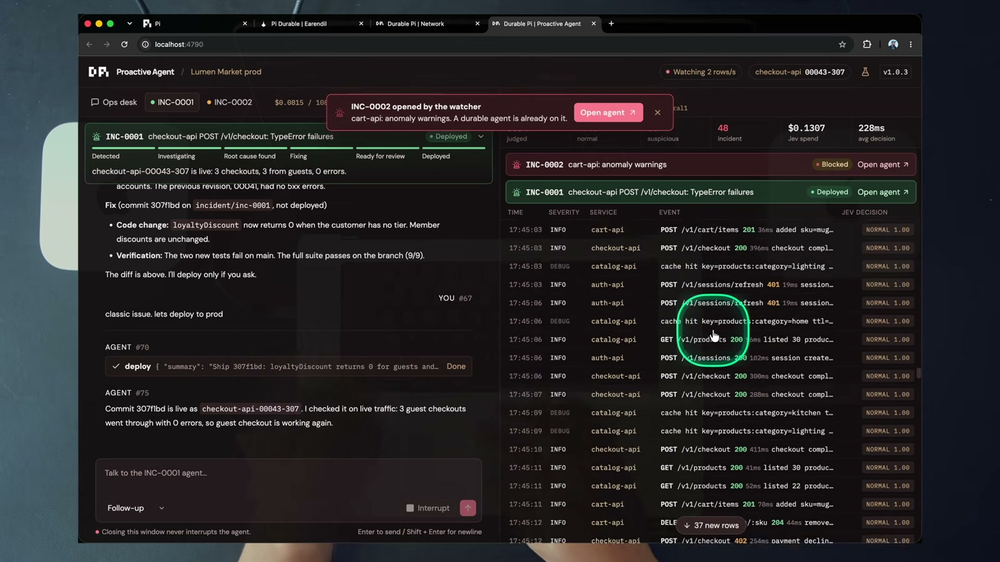

*26:50, 48 incidents judged, $0.13 of dev spend, 228 ms average decision. Dan's other counters during the video: 6 cents, 13 cents, 16 cents. 6,000 rows for 16 cents.*

His adoption rule at 31:36: all product work gets a durable agent by default. And the KPI he wants engineers to track is a good one: **how many agents are doing useful work for you right now, without you?**

I have mixed feelings about that KPI, but I don't have a better one. "Agents doing useful work without me" is at least measurable, unlike "am I leveraging AI effectively".

## The honest part

This is where the post stops being a video summary.


- **`pi-durable` is experimental, pinned at `1.0.3`.** Dan says it himself at 25:31: he cannot deploy it to production without forking and maintaining it, and he doesn't want to. Everything here is a preview of a shape, not a vetted dependency.
- **Durable means checkpointed, not exactly-once.** A `requestId` is admitted once, but an external effect (a payment, a page, a deploy) may have happened right before a crash. The `interrupted` tool result is a good design, not a magic wand. Effects still need their own idempotency.
- **A token is a shell.** Anyone with a device's token runs commands as that device's user. `start_dirs` only says where sessions begin. It is not a sandbox.
- **LAN `ssh` devices speak plain HTTP**, so tokens cross the LAN in cleartext. `exe.dev` devices use HTTPS, and their proxy is public, so the token is the only gate.
- **The hub holds every token.** It binds `127.0.0.1` and checks Host and Origin headers. Bind it to your LAN and you published your fleet.
- **`jev-damage-control` fails open.** If Jev is unreachable, the command runs. It is a third-party dependency sitting in the hot path of your agent's shell.
- **The proactive demo has no login** and its agents run `bash`. It binds `127.0.0.1` unless you pass `--host 0.0.0.0`.
- **macOS devices run as a LaunchAgent** in the logged-in session, so unattended reboots need auto-login.
- **Multiplayer is the least convincing claim.** Sharing an agent is a UI feature. The interesting problem is two humans disagreeing about a deploy approval, and the demo does not touch it.
- **Nothing here addresses cost governance across a fleet.** His counter shows cents because the classifier is cheap. A fleet with a 15 minute polling loop is a different bill.

One more, from me and not from the repo: nobody in this demo has to decide *which* incident is worth an agent. The classifier does that with a threshold, and thresholds are a blunt instrument. Three verdicts with one fingerprint in 120 seconds is a reasonable rule for a mock store. For your production it might page you 40 times a night, or never, and you won't know which until you try.

I did not run any of this. The pass counts in the README (`just check`, 28 of 28 web checks, 18 of 18 on a cloud VM, e2e with a restart mid-tool) are the author's claims. Treat them as claims.

## How I would actually try it

Not war stories. A checklist I would work through, mostly copied from the repo's boundaries and the drills in my notes:

- Pick **one** internal event stream worth wrapping. A 5xx rate, a failed deploy, a queue backlog. Write the threshold down before touching code.
- Put a cheap classifier in front of it. Jev, a small local model, or plain code for `>=N` errors in `M` seconds. Store the verdicts as data, not prose.
- Write the incident SOP as explicit phases **before** writing code. If you cannot name the phases, you do not have a workflow.
- Make the approval a real task with a real wait, not a Slack message you might miss.
- Give the agent a state document with a schema, and atomic path writes or nothing.
- Run the fork test: kill the process mid-tool and prove the tool does not re-fire its side effect.
- Price it. Per-row classifier cost times real row volume, plus agent cost per incident. Compare with one hour of on-call engineer time.
- Read `apps/dpi-backend/API.md` before copying anything. The contract is the product here.
- Steal the shell, not the whole repo. `dpi-tui` plus `/v1` plus one SQLite per session is a weekend. The hub, the proxy and the Vue client are the expensive 80 percent.

If I ever run it, the install path is:

```bash
cp .env.example .env                           # OPENROUTER_API_KEY
cp dpi-network.example.yaml dpi-network.yaml   # devices; starts with just `local`
just install
just net up local                              # ~/.dpi/backend.env + token + registry entry
just hub build
just backend run                               # :4780
just hub start                                 # :4781
just tui attach local
just proactive take                            # demo: bad deploy at 5s, approval at ~30s
```

And the repo itself, for scale: 106 TypeScript files, 14,323 lines, 22 Vue files, 75 markdown files. `pi-durable` pinned `1.0.3`.

```text
durable-pi/
├── dpi-network.example.yaml      # devices by kind: local | ssh | exe-dev | url
├── justfile + just/              # install, check, net, backend, hub, tui, test, proactive
├── apps/
│   ├── dpi-sdk/                  # /v1 contract, client, reducers, transcript, registry
│   ├── dpi-backend/              # device server: REST v1, SSE, bearer auth, jobs, extensions
│   │   ├── API.md                # every route, stream, recipe
│   │   ├── prompts/              # smart_ass_opus_fix.md, one_sentence.md
│   │   └── deploy/               # launchd plist, systemd unit, backend.env.example
│   ├── dpi-playground/           # hub (registry, proxy, SSE mux) + Vue 3 client
│   ├── dpi-tui/                  # pi-like terminal client
│   └── proactive-dpi-demo/       # Jev log watcher, incident agents, durable deploy approval
├── images/                       # 20 numbered diagrams, reading order
├── ai_docs/                      # pi + pi-durable doc snapshots
└── .claude/                      # /install, /prime, agent-sandboxes skill
```

## So what did I actually take from it

Two things, and neither of them is "install this now".

First, the framing is right. Resume restores a chat. Durability restores the work. Once you see the difference, a lot of agent tooling around you starts looking like a very nice chat window with no memory of what it was doing.

Second, the layering is right. Code owns thresholds, a cheap classifier owns bounded judgments, the agent owns open-ended work, and a human owns the approval. Four layers, each doing what it is good at. That is not a Pi feature, that is a design you can copy into anything, including your homelab.

Pi Durable itself needs a 1.0 before I put it near production, and Dan agrees. But the shape of it, an agent that works before you wake up and then waits politely at the deploy, that I want.

Cheers. 🥦

## Sources

- Video: [Pi Durable PROACTIVE Agents: Jev Triggers My ON-CALL Pi Agent](https://www.youtube.com/watch?v=DNDYYHsypZg), IndyDevDan, 2026-10-12, 35:16
- Repo: [disler/durable-pi](https://github.com/disler/durable-pi), TypeScript, MIT, read at commit `37165c6`
- API contract: [`apps/dpi-backend/API.md`](https://github.com/disler/durable-pi/blob/main/apps/dpi-backend/API.md)
- Pi Durable release announcement: [earendil.com/posts/pi-durable](https://earendil.com/posts/pi-durable/)
- My research note and the full transcript live in my Obsidian vault under `3-resources/agentic-engineering/`

>Material for this post, and some parts of the post are AI assisted.
Models used while working on this post:
- deepseek-v4.1-flash (ollama cloud), research note and repo reading
- qwen3.8-flash (ollama cloud), blog post draft
