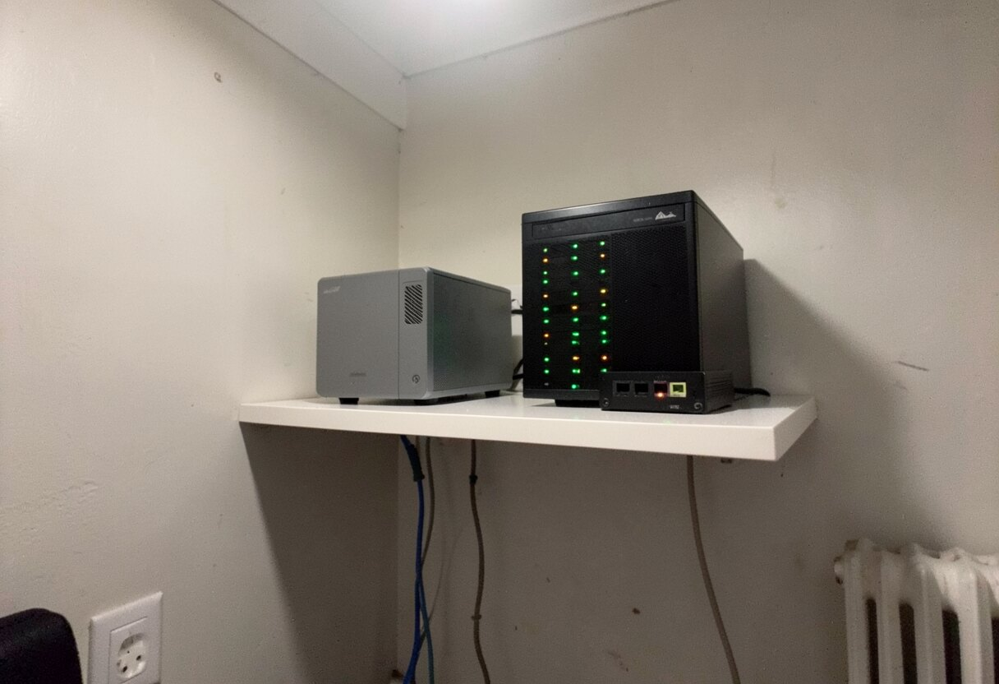
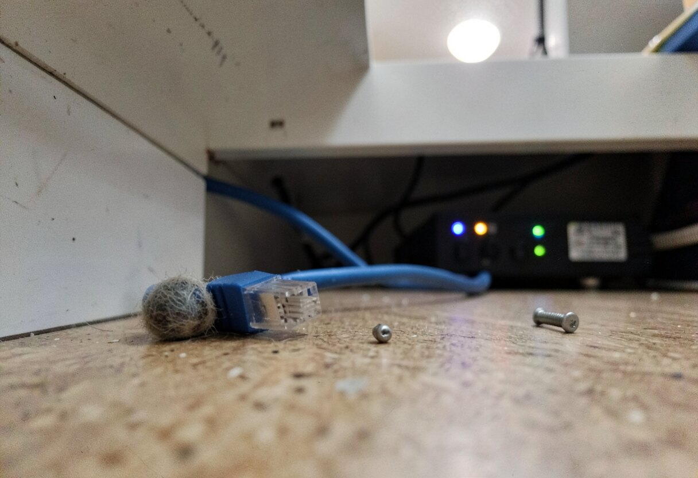
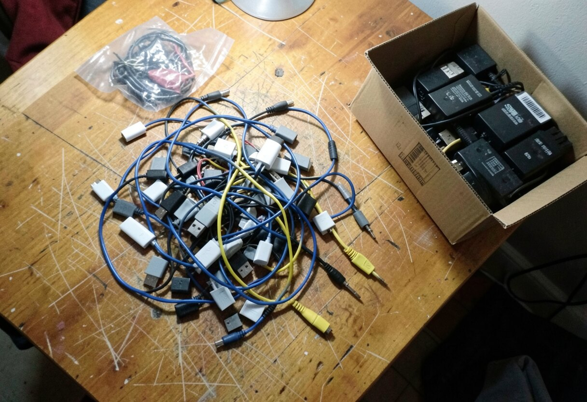
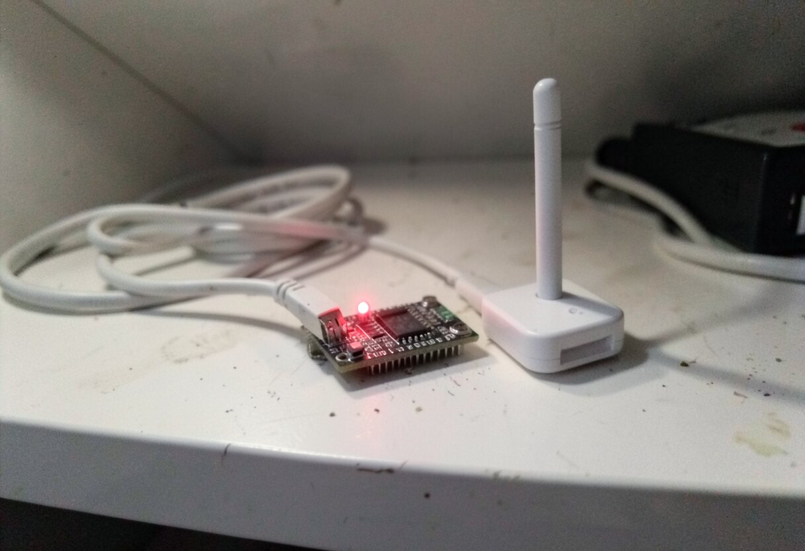
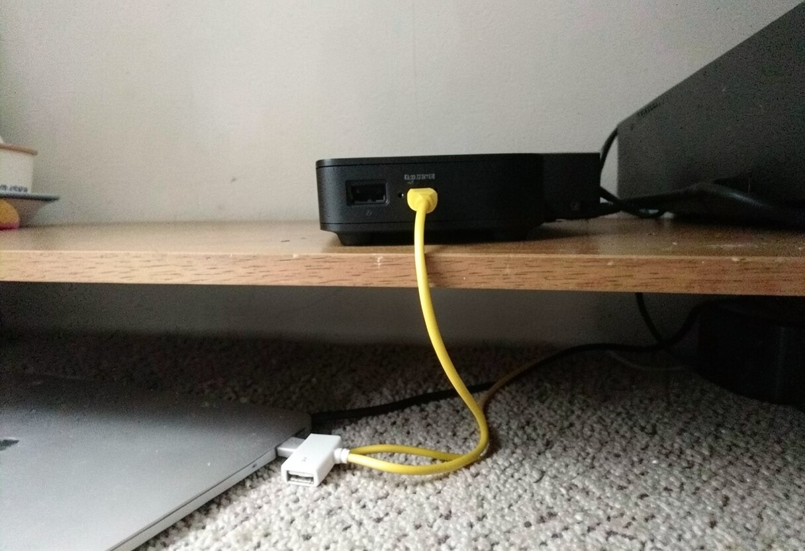
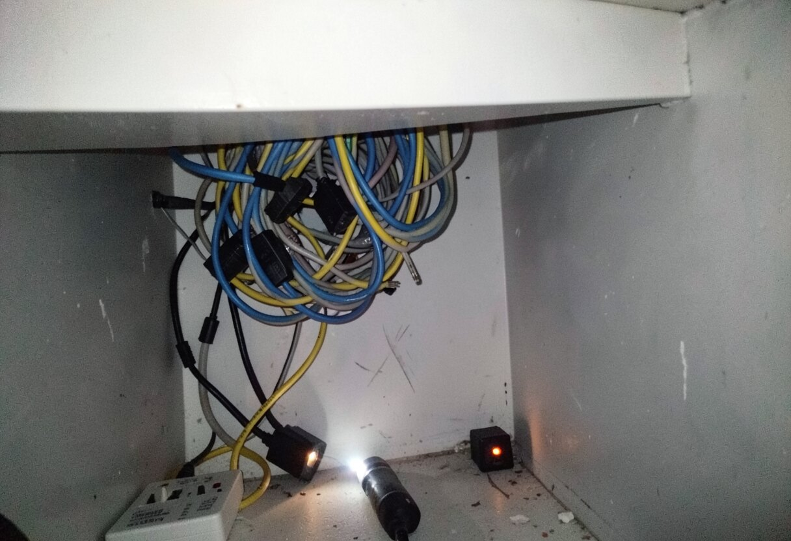
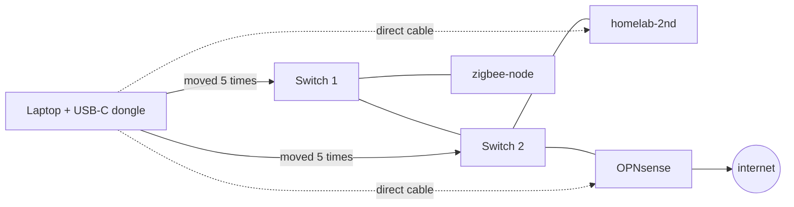
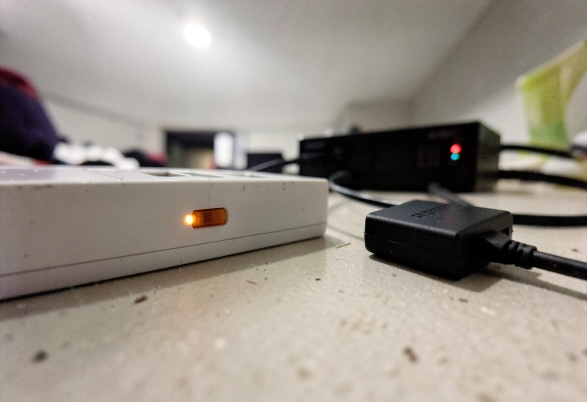
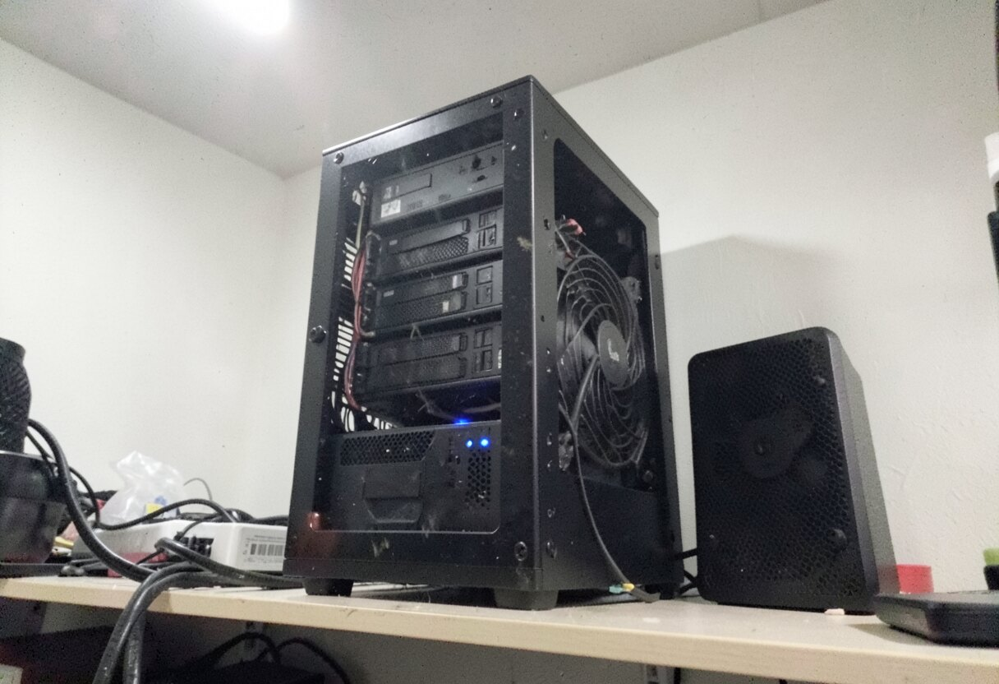
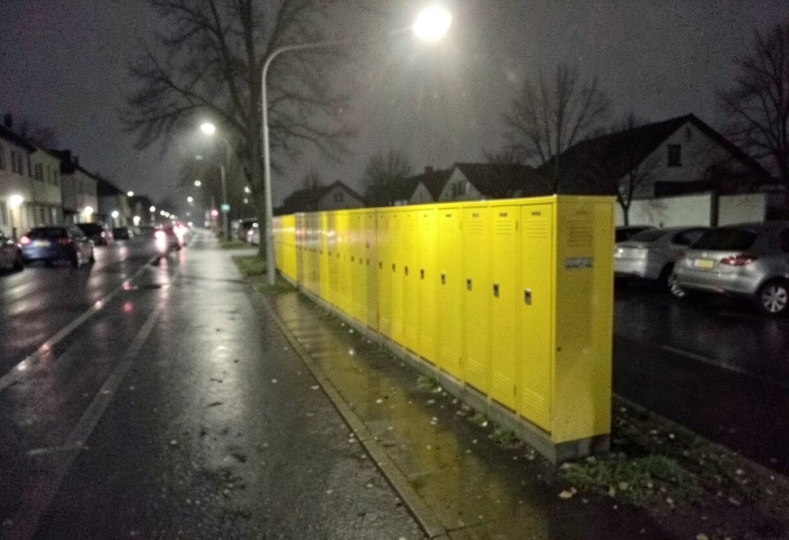

There is nothing more frustrating than coming back home and figure out entire network is flat, even if all devices are healthy.

I am not exaggerating. I walked in, looked at the shelf, and everything was blinking. Switches blinking like hell. Router alive. Server alive. Every LED in the flat telling me "all good boss". And no internet.

So I did what every respectable team lead does in 2026. I opened laptop, connected it to OPNsense with ethernet cable and asked Claude Code:

> are you able to login over ssh to opnsense and tell me why there is no internet coming from opnsense?

What followed took 5 cable moves, one USB-C dongle getting accused of crimes, and at the end the most embarrassing fix in entire IT history. But let's go in order 😅

## First suspect: the router

So my router is OPNsense running on old Samsung laptop. Yes, really. Password for it sits encrypted with sops in my homelab repo, because I am very professional person.

Claude Code decrypted it without showing it to anybody, tried to login and got this:

```
root@10.0.0.1: Permission denied (publickey).
```

Thanks to past me, who disabled password login over ssh and then forgot about it. So all this lovely sops encryption was protecting password which does not work 🤦

Fine, no ssh. However you don't need to login into router to test if router is routing. You just ask it to route something:

```
❯ ping -I enp0s13f0u1c2 -c3 1.1.1.1
3 packets transmitted, 3 received, 0% packet loss
rtt min/avg/max/mdev = 16.138/16.843/17.308/0.507 ms
```

0% packet loss, 17 ms. So internet was there. Whole time. It was me who was not able to use it.


*Router, found innocent. Interrogated with one blue cable and one white dongle.*

## It's always DNS (nobody is surprised)

Next finding was this one. DHCP on my network hands out exactly one DNS server, and this server is Pi-hole. Pi-hole runs in k3s, on homelab-2nd. And homelab-2nd was not on the wire:

```
❯ ip neigh show 10.0.0.179
10.0.0.179 dev enp0s13f0u1c2 INCOMPLETE
```

I wrote down this risk in my own ADR some months ago, word by word: "Pi-hole down = home offline". Very smart. Could have been also a post-it on my forehead.

Road to internet wide open. Only guy who knows the addresses did not come to work.

So Claude Code came with the theory: rack is off, or something is not plugged in. Reasonable. Also wrong. Because homelab-2nd is all the time up and running, and I was looking at it.



*The "something is not plugged in" theory, as Claude Code imagined it.*

## The cable tour begins

Now starts the part where I am useful, as I am only component of this system with legs.

Small context about my network: this is not some rack with managed switches. There are two small 8 port switches, tplink or dlink, I don't even remember which, sitting there for years. My laptop has no ethernet port, so everything goes through USB-C dongle. And I started to plug this dongle everywhere.



*Inventory of my network strategy.*

**Cable move 1:** laptop to first switch, the one where homelab-2nd should be visible. No DHCP lease. Link up at 1 Gbit, lights nice, nobody answers. And then in tcpdump this appears:

```
Request who-has 10.0.0.179 tell 10.0.0.120
Request who-has 10.0.0.180 tell 10.0.0.120
Request who-has 10.0.0.111 tell 10.0.0.120
Request who-has 10.0.0.179 tell 10.0.0.120
```

Every second. Forever. Unknown device, not in my repo, shouting for three of my machines into empty room. For a moment it was quite a creepy feeling.

We found out later this was zigbee-node, my small Orange Pi with Zigbee dongle. It was looking for k3s control plane, for NAS and for other worker. Nobody picked up.



*zigbee-node, around 19:30. Very loyal little board.*

## Direct cable: the patient is alive

**Cable move 2:** Claude Code asks if homelab-2nd is powered on. I am slightly offended on behalf of homelab-2nd and I plug laptop directly to it. No switch, nothing, one cable, two devices.

And suddenly:

```
Request who-has 10.0.0.162 tell 169.254.202.153
Request who-has 1.1.1.1 tell 169.254.202.153
Request who-has 198.41.200.13 tell 169.254.202.153
```

`169.254.x.x`. So homelab-2nd was alive and it forgot who it is. No DHCP, so it gave itself emergency address and started asking on the wire for entire internet, including its own old address. Cloudflare tunnels were still trying to dial out from inside. I found this one a bit touching.

To talk to it we needed address from same range, and here we lost some time, because NetworkManager kept retrying DHCP and silently removing every address Claude Code added by hand. Solution is to tell it to go away for a moment:

```sh
sudo nmcli device set enp0s13f0u1c2 managed no
sudo ip addr add 169.254.10.10/16 dev enp0s13f0u1c2
```

After that ping worked, and my kubeconfig also worked, with one small trick, as certificate does not know about this emergency address:

```sh
kubectl --context homelab-2nd \
  --server=https://169.254.202.153:6443 \
  --tls-server-name=kubernetes \
  get nodes
```

```
NAME          STATUS     ROLES
arr-box       NotReady   worker
homelab-2nd   Ready      control-plane
t460          NotReady   worker
zigbee-node   NotReady   worker
```



*Patient has a heartbeat, does not remember own house number.*

So control plane healthy, Pi-hole pod `2/2 Running`, all three workers lost within 31 seconds at 17:11. Nothing crashed. They all lost each other at same moment. That smells like network and not like machines, so I was back to the switches.

## More cables, more nothing

**Cable move 3:** I recabled everything back. Laptop on the switch. Still no lease. Still only zigbee-node shouting.

**Cable move 4:** laptop to the other switch, the one with OPNsense and homelab-2nd. Now tcpdump was finally full of life: Espressif things, Xiaomi, Huawei, even zigbee-node, which by the way proves switches are connected to each other. So Claude Code's "link between the switches is dead" theory also died.

But OPNsense? Nothing. homelab-2nd? Nothing. And when Claude Code tried to talk to five devices which were clearly alive and transmitting in the same moment:

```
10.0.0.109: Received 0 response(s)
10.0.0.199: Received 0 response(s)
10.0.0.182: Received 0 response(s)
10.0.0.138: Received 0 response(s)
10.0.0.120: Received 0 response(s)
```

Everybody talking, nobody listening. On top of that laptop adapter was showing 116 transmit errors, up from 0. So USB-C dongle went to the suspect list, with cable, port, switch and my life choices.



*Technical term for this activity is "layer 1 troubleshooting". I was on my knees for it, which feels correct.*



Direct cable to anything worked. Same dongle, sometimes same machines. Through the switches, nothing worked. And both switches were blinking the whole time, happy as Christmas tree.

## Have you tried turning it off and on again?

Claude Code wrote me list of 5 things to try. Number 1, because it was the cheapest: pull power from both switches, wait 30 seconds, plug back.



*30 seconds of silence. Longest of the evening.*

I plugged them in. And from the shelf I heard this:



*OMV realizing it has almost 3 hours of work to catch up with.*

My NAS suddenly started to work like really hard. Best sound I heard this week. !! BOOM !!

```
❯ kubectl get nodes
arr-box       Ready
homelab-2nd   Ready
t460          Ready
```

Lease on laptop. Pi-hole answering. MinIO healthy. No config changed. Not one line of YAML, nothing in Git. In GitOps homelab, the fix was not committed anywhere 🫠

## It was not over

Right after network came back cluster looked horrible: 17 pods in `CrashLoopBackOff`, half of CNPG databases `Waiting`. I wanted to panic. Claude Code said let's wait 4 minutes. And yes, after 4 minutes all 12 databases were healthy and crash loops were gone. They just needed their friends back. Trust me, don't touch anything for first 5 minutes.

Then I asked to check Paperclip, this is where my AI agents company lives, on separate MacBook Air outside of the cluster. And public URL gave 200, so all good, right?

Nope. 200 was only front page. Real API:

```
❯ curl -m 25 http://localhost:3100/api/health
code=000 t=25.004028
```

First theory: connections died with the network. Wrong again, Postgres was seeing all of them. What it showed was much funnier:

```
idle in transaction | Client:ClientRead    | 26 minutes
idle in transaction | Client:ClientRead    | 25 minutes
active              | Lock:transactionid   | blocked
active              | Lock:tuple           | blocked
active              | Lock:tuple           | blocked
... (8 of those)
```

All 10 connections from the pool used. 2 sitting in transaction, waiting for application. 8 waiting for lock held by those 2. And application, as far as we can tell from database side, could not finish as it had no free connection left.


*Paperclip, 20:27. Polish post office, 1994. Same queue.*

Fix for that was exactly the same as for network, only with more syllables:

```sh
sudo launchctl kickstart -k system/<my-label>.paperclip
```

Yes. Off and on again. Second time this evening.

Third time was zigbee-node. It came through the whole outage shouting, and after the switches rebooted it went completely silent, so I went and pulled power from the Orange Pi. 18 Zigbee devices came back. And M1 Max was sleeping through all of that, so I woke it with JetKVM, which is also a form of turning on.

## What I know and what I don't

| Thing | Status |
|---|---|
| Time of death | 17:11 |
| Network down for | about 2 h 45 min |
| Debugging until the fix | about 30 min |
| Fix | 30 seconds |
| Cable moves | 5 |
| Lines of YAML changed | 0 |
| Things turned off and on | 3 |
| Root cause | no idea |

I have to be honest here, I don't know what happened to these switches and I don't know even which one was guilty, as I rebooted both in the same moment. Very scientific. The dongle was innocent, by the way: errors stopped at 195 and never came back. It went back to work without apology from anybody.

What I take from it: blinking light means there is electricity, and that's all it means. Next time I start from power cycle of 2 cheap switches, and only after that I start the investigation.

Now oatmeal is baking for tomorrow's breakfast and I am going to Packstation to pickup a parcel. After a day like that I think universe owes me one thing which works at first try.



Fingers crossed for DHL 🤞
